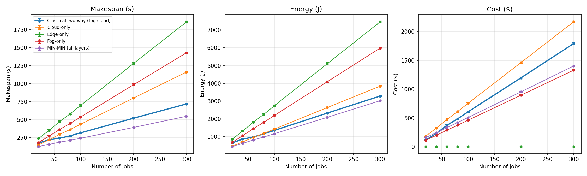
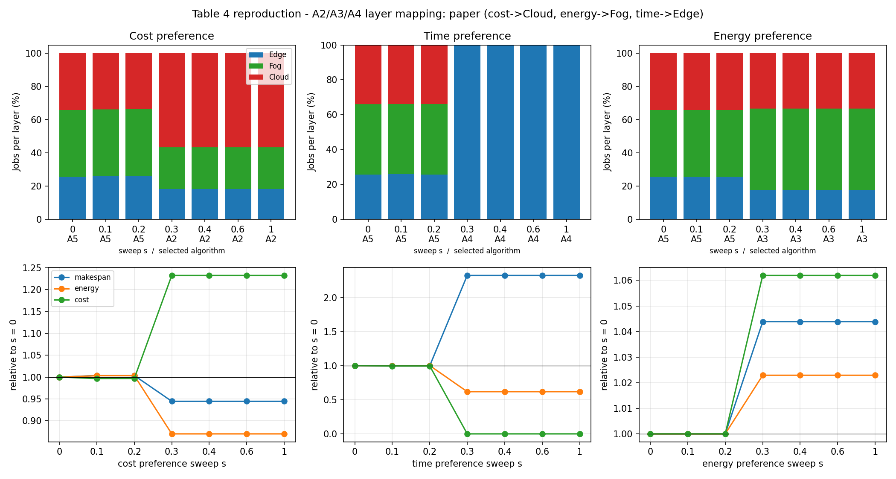
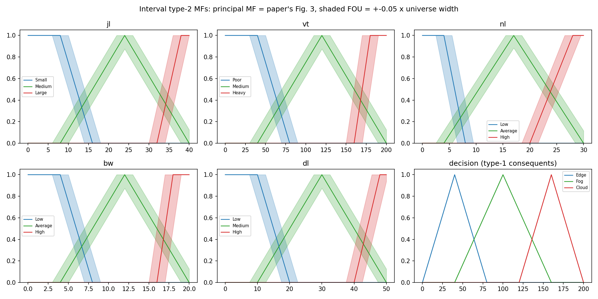
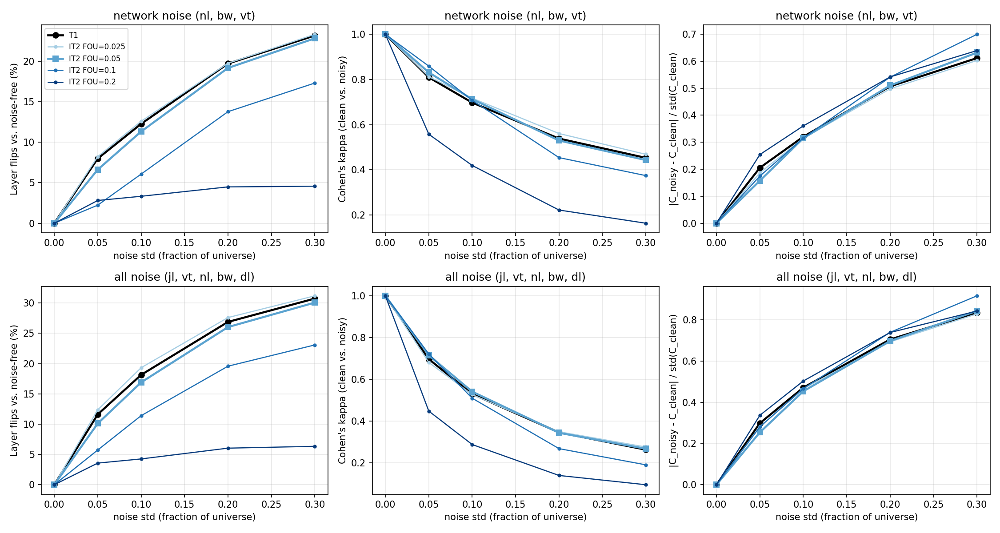
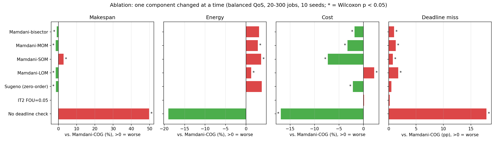

# Fuzzy Logic-Based Computation Offloading in Fog Computing — Reproduction & Type-2 Extension

> Fuzzy Logic course term project. Technical report (Turkish): [`report/report.pdf`](report/report.pdf) ·
> slides (Turkish): [`presentation/presentation.pdf`](presentation/presentation.pdf) · live demo: [`demo/demo.py`](demo/demo.py).

## Student Information
- Name: Zeynep Pınarlı
- Student ID: 1306220076
- GitHub: [@pinarlizeynep](https://github.com/pinarlizeynep)
- Course: Bulanık Mantık (Fuzzy Logic), Fall 2026

## Original Paper
D. Soni and N. Kumar, "Fuzzy logic-based computation offloading technique in fog computing,"
*Concurrency and Computation: Practice and Experience*, vol. 36, no. 20, p. e8198, 2024,
doi: [10.1002/cpe.8198](https://doi.org/10.1002/cpe.8198).

## Problem Description
IoT devices generate workflow jobs that must be executed on one of three computing layers —
**edge**, **fog**, or **cloud**. The choice affects makespan, energy consumption and monetary cost,
and it must be made under uncertain, rapidly changing conditions (load, latency, bandwidth, deadlines).
The reference paper uses a Mamdani fuzzy inference system to make this offloading decision.

## Project Scope
1. **Reproduction** — Python re-implementation of the paper's 5-input Mamdani FIS
   (job list size, VM utilization, network latency, bandwidth, deadline → edge/fog/cloud)
   inside a lightweight workflow simulator modelled on the paper's FogWorkflowSim settings
   (MONTAGE-like workflows, MIN-MIN scheduling, 20–300 jobs).
2. **Proposed extension** — Interval Type-2 fuzzy offloading and a noise/robustness analysis,
   plus a Mamdani-vs-Sugeno / defuzzification ablation.

## Repository Structure
```
src/            fuzzy/ engine, env/ nodes, workflow/ generator, scheduler/ MIN-MIN, policies/
data/           generated workflows and random seeds
experiments/    baseline/ and proposed/ experiment scripts
results/        figures/ and tables/
demo/           live demo
tests/          unit tests
docs/           project plan and paper analysis (Turkish)
report/         technical report (PDF)
presentation/   slides (PDF)
references/     bibliography
```

## Method
Two fuzzy decision layers, as in the paper (Algorithms 1-5):
1. **QoS selector** ([`qos_selector.py`](src/fuzzy/qos_selector.py)) — the user's time / energy / cost
   preference in [0, 1]³ is fuzzified (Low / Medium / High) and the 16 rules of Table 2 select one of
   A2 (cost), A3 (energy), A4 (time) or A5 (hybrid).
2. **Offloading FIS** ([`paper_fis.py`](src/fuzzy/paper_fis.py)) — for A5, the simulator state is mapped to
   five inputs (`observe` in [`fuzzy_policy.py`](src/policies/fuzzy_policy.py)), the 243-rule Mamdani FIS
   returns a crisp value in [0, 200] and the thresholds 60 / 140 pick Edge / Fog / Cloud.
3. **Offloading condition** — if the chosen layer would miss the task's deadline and another layer would
   not ("dl not met", Alg. 5), the layer with the earliest expected finish is used.
4. **MIN-MIN** places the task on the best node of the chosen layer.

The extension replaces only step 2: interval type-2 FIS ([`it2.py`](src/fuzzy/it2.py)) or zero-order
Sugeno FIS ([`sugeno.py`](src/fuzzy/sugeno.py)); everything else is shared.

## Dataset
No external dataset is needed. Workloads are **synthetic MONTAGE workflows** generated from a seed by
[`src/workflow/montage.py`](src/workflow/montage.py) (structure of the Pegasus Montage workflow, task
lengths close to the per-type means of real MONTAGE traces ±20 %, per-task deadline slack). Node
parameters come from the paper's Table 3 ([`src/env/nodes.py`](src/env/nodes.py)). Seeds 0-2 were used
only to calibrate input scales and the main FOU; all reported results use seeds 100-109. The values read
off the paper's figures and tables for comparison are in [`data/`](data).

## Installation
```bash
git clone https://github.com/pinarlizeynep/bulanikMantik.git
cd bulanikMantik
py -3.12 -m venv .venv
.venv\Scripts\activate        # Windows  (Linux/macOS: source .venv/bin/activate)
pip install -r requirements.txt
```

## Requirements
Python 3.12 — see [`requirements.txt`](requirements.txt) for pinned library versions.

## Fuzzy System Architecture
Mamdani FIS implemented from scratch in [`src/fuzzy/`](src/fuzzy) and cross-checked against scikit-fuzzy.

| Variable | Universe | Terms (MFs read from the paper's Fig. 3) |
|---|---|---|
| Job list size `jl` | [0, 40] | Small `trap(0,0,8,16)`, Medium `tri(8,24,40)`, Large `trap(32,38,40,40)` |
| VM utilization `vt` | [0, 200] | Poor `trap(0,0,40,80)`, Medium `tri(40,120,200)`, Heavy `trap(160,180,200,200)` |
| Network latency `nl` | [0, 30] | Low `trap(0,0,4,8)`, Average `tri(4,17,30)`, High `trap(20,28,30,30)` |
| Bandwidth `bw` | [0, 20] | Low `trap(0,0,4,8)`, Average `tri(4,12,20)`, High `trap(16,18,20,20)` |
| Deadline `dl` | [0, 50] | Low `trap(0,0,10,20)`, Medium `tri(10,30,50)`, High `trap(40,48,50,50)` |
| **Decision** (output) | [0, 200] | Edge `tri(0,40,80)`, Fog `tri(40,100,160)`, Cloud `tri(120,160,200)` |

- **Inference:** AND = min, implication = min, aggregation = max, defuzzification = centroid (COG).
- **Decision thresholds:** crisp < 60 → Edge, 60–140 → Fog, > 140 → Cloud.
- **Rule base:** all 3⁵ = 243 rules are generated by a term-scoring scheme
  ([`paper_fis.py`](src/fuzzy/paper_fis.py)). The paper publishes only 3 example rules; the scheme
  reproduces all three of them.


## How to Run
```bash
# explain a single offloading decision (fuzzification -> fired rules -> defuzzification)
python -m src.fuzzy.paper_fis --jl 10 --vt 50 --nl 25 --bw 3 --dl 8

# membership-function figure, control surfaces, decision statistics
python -m experiments.fis_analysis

# baseline experiment: 20-300 jobs x 10 seeds x 5 policies
python -m experiments.baseline.run_baseline

# reproduction of the paper's Fig. 4 (proposed vs. classical) and Table 4 (QoS preferences)
python -m experiments.proposed.reproduce_fig4
python -m experiments.proposed.reproduce_table4

# extension: type-1 vs. interval type-2 under measurement noise (~2 min) and ablation (~1.5 min)
python -m experiments.proposed.robustness_it2
python -m experiments.proposed.ablation

# interactive live demo (single decisions, a simulation, noise)
python -m demo.demo

# unit tests (113 tests, includes a cross-check against scikit-fuzzy; ~3 min)
python -m pytest
```

## Simulator
FogWorkflowSim (Java) is replaced by a small Python simulator so that the paper's method and the
baseline run on **identical** workflows, nodes and network.

| Module | Content |
|---|---|
| [`src/env`](src/env) | Edge / fog / cloud nodes with the paper's Table 3 parameters (2 nodes per layer by default), network transfer model |
| [`src/workflow`](src/workflow) | Seeded MONTAGE-like DAG generator with exactly *N* tasks (Montage_25 = 5 mProjectPP + 9 mDiffFit, as in Pegasus) |
| [`src/scheduler`](src/scheduler) | MIN-MIN list scheduling; the offloading policy picks the layer when a task becomes ready, MIN-MIN picks the node. Metrics: makespan (Eq. 12), energy (busy + idle power), cost (execution + communication), deadline miss rate |
| [`src/policies`](src/policies) | Proposed fuzzy offloading (Algorithms 1-5), baseline two-way fog-cloud offloading (Khan et al. 2023), single-layer and all-layer MIN-MIN reference policies |

Assumptions the paper leaves open (units, pricing, latency per layer) are documented in
[`src/env/nodes.py`](src/env/nodes.py); deliberate deviations from the paper (per-task deadlines instead
of the "15 unit deadline", Table 3 MIPS instead of the 1200-1600 MIPS range of Sec. 2.1, cost per MB
instead of Eq. 6/15, only the deadline part of the offloading condition Eqs. 16-18, crisp thresholds
60/140 in place of the unspecified λ_i of Alg. 5) are stated in the docstrings of
[`montage.py`](src/workflow/montage.py), [`nodes.py`](src/env/nodes.py),
[`qos_selector.py`](src/fuzzy/qos_selector.py) and [`fuzzy_policy.py`](src/policies/fuzzy_policy.py). Energy counts idle power only for nodes that executed at
least one task (`simulate(..., idle="used")`; `idle="all"` keeps every node powered on).

## Reproduction Experiments
**Baseline** (classical two-way fog-cloud offloading), mean of 10 seeds — full table in
[`results/tables/baseline_summary.csv`](results/tables/baseline_summary.csv):

| Jobs | Makespan (s) | Energy (J) | Cost ($) | Cloud share |
|---|---|---|---|---|
| 20 | 174 | 412 | 120 | 8.5 % |
| 100 | 317 | 1334 | 609 | 49.7 % |
| 300 | 717 | 3240 | 1792 | 53.6 % |



**Proposed fuzzy offloading vs. baseline** (Fig. 4 reproduction, 7 job counts x 10 seeds, balanced QoS
preference, paired runs on identical workflows; positive = proposed is better):

| Metric | Improvement, mean ± std | Runs where proposed wins | Paper (reported) |
|---|---|---|---|
| Makespan | +4.0 ± 4.2 % | 79 % | 7.51 % |
| Energy | −4.2 ± 9.0 % (worse) | 10 % | 4.63 % |
| Cost | +21.9 ± 3.1 % | 100 % | 13.60 % |


The makespan and cost gains are reproduced in direction; the energy gain is **not** (details and
the reason in [`docs/gunluk/gun4_2026-11-10.md`](docs/gunluk/gun4_2026-11-10.md)).

**QoS preferences (Table 4 reproduction).** With the published layer mapping (cost→cloud, energy→fog,
time→edge) the trends of the paper's Table 4 are not reproduced: edge-only execution is the *cheapest
and most frugal* but slowest, a cloud-heavy mix is the *fastest* but most expensive — the opposite of
the paper's labels, because the paper's own Table 3 makes the cloud fast but expensive and the edge
free but slow. A sensitivity run with the physically consistent mapping is in
[`results/figures/table4_physical_mapping.png`](results/figures/table4_physical_mapping.png).



## Proposed Extension
**Interval type-2 (IT2) fuzzy offloading + measurement-noise robustness** — the paper motivates fuzzy
logic with uncertainty, but its type-1 MFs do not model uncertainty in the measurements themselves.

| Part | Where | What |
|---|---|---|
| IT2 MFs | [`src/fuzzy/it2.py`](src/fuzzy/it2.py) | Principal MF = the paper's Fig. 3 MF. FOU = all values the MF takes when the reading is off by up to ±δ, δ = `fou` × universe width: `UMF(x) = max μ(z)`, `LMF(x) = min μ(z)` for z in [x−δ, x+δ]. One parameter, closed form, `fou = 0` → type-1 |
| IT2 Mamdani FIS | same file, `build_it2_fis()` in [`paper_fis.py`](src/fuzzy/paper_fis.py) | Same 243 rules and operators (min / min / max) on lower and upper degrees → firing intervals → IT2 output set → **Karnik-Mendel** type reduction → `(y_l + y_r)/2` → paper's thresholds 60 / 140. Rule compilation is reused from the type-1 engine; `fou = 0` reproduces the type-1 crisp output (tested to 1e-9) |
| IT2 policy | `IT2OffloadingPolicy` in [`fuzzy_policy.py`](src/policies/fuzzy_policy.py) | Subclass of the proposed policy; only the FIS changes |
| Noise model | `InputNoise` | Gaussian noise on the observed FIS inputs, std = level × universe width, clipped; the draw depends only on (seed, task), so both FIS see the same errors |
| Experiment | [`robustness_it2.py`](experiments/proposed/robustness_it2.py) | 5 noise levels × 2 scenarios (`network`: nl, bw, vt; `all`: all five) × T1 + IT2 FOU 0.025-0.2, MONTAGE 20-300 jobs, seeds 100-109, paired tests |

```bash
python -m src.fuzzy.paper_fis --jl 10 --vt 50 --nl 25 --bw 3 --dl 8 --fou 0.05   # T1 vs IT2 for one decision
python -m experiments.proposed.robustness_it2                                     # ~2 min
```

The main configuration **FOU = 0.05** was fixed on the tuning seeds 0-2 (largest FOU whose noise-free
makespan / energy / cost stay within ~1 % of type-1) before running the test seeds.
Decision stability is measured at the identical simulator state: every noisy decision is compared
with the decision on the clean inputs. Because a FIS that answers "Fog" to everything never flips,
Cohen's kappa (agreement corrected for chance) is reported next to the flip rate.



## Experimental Results
**IT2 (FOU 0.05) vs. type-1 under noise** — layer flips vs. the noise-free decision, mean over 50 paired
runs ([`robustness_summary.csv`](results/tables/robustness_summary.csv),
[`robustness_paired.csv`](results/tables/robustness_paired.csv)):

| Noise std | `network` flips T1 → IT2 | kappa T1 → IT2 | Wilcoxon p | `all` flips T1 → IT2 | kappa T1 → IT2 | Wilcoxon p |
|---|---|---|---|---|---|---|
| 0.05 | 8.0 % → **6.6 %** | 0.81 → 0.83 | **0.002** | 11.6 % → **10.1 %** | 0.70 → 0.72 | **0.014** |
| 0.10 | 12.3 % → 11.3 % | 0.70 → 0.71 | 0.13 | 18.1 % → 16.9 % | 0.53 → 0.54 | 0.44 |
| 0.20 | 19.7 % → 19.2 % | 0.54 → 0.53 | 0.47 | 26.9 % → 26.0 % | 0.35 → 0.34 | 0.43 |
| 0.30 | 23.2 % → 22.8 % | 0.45 → 0.44 | 0.50 | 30.7 % → 30.1 % | 0.26 → 0.27 | 0.95 |

| FIS (noise-free) | Makespan (s) | Energy (J) | Cost ($) | Deadline misses | FIS says Edge / Cloud | µs per decision |
|---|---|---|---|---|---|---|
| Type-1 (paper) | 369.4 | 1721 | 643.5 | 21.9 % | 19 % / 5.3 % | 47 |
| IT2 FOU 0.05 | 369.0 | 1720 | 643.0 | 22.2 % | 19 % / 5.5 % | 116 |
| IT2 FOU 0.1 | 398.4 (+7.9 %) | 1833 | 629.5 | 22.1 % | 16 % / 1.4 % | 136 |
| IT2 FOU 0.2 | 404.3 (+9.4 %) | 1841 | 649.8 | 22.0 % | 4 % / 0 % | 259 |

- **Small noise:** IT2 (FOU 0.05) removes 13-18 % of the noise-induced layer flips (significant), at
  the same makespan / energy / cost. **Large noise:** no significant difference — a FOU of ±5 % cannot
  absorb errors of ±10-30 %.
- **Wide FOU is not "more robust":** FOU 0.2 flips only ~3-6 % of the decisions, but kappa drops to
  0.1-0.5 because type reduction pulls almost every output to the middle (Fog). The paper's decision
  becomes uninformative and the noise-free makespan worsens by 9 %. FOU trades decisiveness for stability.
- **System-level robustness comes mostly from the deadline check:** with noise of 0.3 on all inputs the
  type-1 policy's makespan rises only 3 % (369 → 381 s), because Alg. 5's "dl not met" check and MIN-MIN
  correct many wrong FIS layers. End-to-end metrics of T1 and IT2 stay within 1 % of each other at every
  noise level; a few paired tests reach p < 0.05, but with changing sign (e.g. makespan with noise on all
  inputs: IT2 0.8 % worse at 0.2, 0.6 % better at 0.3), so IT2 has no consistent QoS advantage.




Details, statistics and limitations (in Turkish): [`docs/gunluk/gun5_2026-11-11.md`](docs/gunluk/gun5_2026-11-11.md).

### Ablation study
One component of the proposed policy is changed at a time (balanced QoS, MONTAGE 20-300 jobs, seeds
100-109, paired against the paper's Mamdani + centroid; [`ablation.py`](experiments/proposed/ablation.py),
zero-order Sugeno FIS in [`src/fuzzy/sugeno.py`](src/fuzzy/sugeno.py)):

```bash
python -m experiments.proposed.ablation        # ~1.5 min
python -m src.fuzzy.paper_fis --jl 10 --vt 50 --nl 25 --bw 3 --dl 8 --sugeno
```

| Variant | Makespan | Energy | Cost | Deadline misses | FIS layer = paper's (random inputs) | µs / decision |
|---|---|---|---|---|---|---|
| Mamdani + centroid (paper) | 0 | 0 | 0 | 0 | 100 % | 51 |
| Mamdani + bisector | **−1.0 %** | +3.2 % | **−1.8 %** | **+1.0 pp** | 93 % | 65 |
| Mamdani + MOM | **−1.5 %** | **+2.9 %** | **−3.3 %** | **+1.3 pp** | 81 % | 60 |
| Mamdani + SOM | **+2.8 %** | **+3.7 %** | **−7.3 %** | **+0.8 pp** | 80 % | 52 |
| Mamdani + LOM | **−1.5 %** | **+1.3 %** | **+2.2 %** | **+1.7 pp** | 79 % | 54 |
| Sugeno (zero-order) | **−1.4 %** | +3.8 % | **−2.2 %** | +0.5 pp | 93 % | **30** |
| IT2 (FOU 0.05) | +0.0 % | +0.0 % | +0.1 % | +0.2 pp | 98 % | 162 |
| No deadline check | **+49.8 %** | −19.0 % | **−16.9 %** | **+17.9 pp** | — | — |

(positive = worse than the paper's configuration; bold = Wilcoxon p < 0.05;
[`ablation_summary.csv`](results/tables/ablation_summary.csv), [`ablation_fis.csv`](results/tables/ablation_fis.csv))

- **Defuzzification / Sugeno:** no variant dominates the paper's centroid; each trades ~1-3 % makespan
  or cost against energy and deadline misses. Among the type-1 systems the centroid is the most
  "conservative" output (smallest spread, most Fog). Sugeno gives nearly the same decisions as the bisector at 40 % less time per
  decision — it would support the paper's "low complexity" claim even better.
- **The deadline check is the most important component.** Without it the FIS alone sends 71 % of the
  jobs to the fog and only 3 % to the cloud, the makespan grows by 50 % and the method becomes 43 %
  *worse* than the classical baseline. Most cloud placements of the proposed method come from the
  "dl not met" check of Alg. 5, not from the FIS.
- **Noise without the deadline check** ([`ablation_noise_nodeadline.csv`](results/tables/ablation_noise_nodeadline.csv)):
  flips do *not* hurt — noise spreads jobs from the crowded fog to edge and cloud, so the makespan even
  falls by up to 9 %. IT2 and T1 again stay within 1 %. The Day-5 hypothesis that flips would reach the
  QoS metrics without the check is therefore rejected for this setting.
- **Energy accounting:** counting idle power of *all* nodes instead of only the used ones changes the
  energy result of Fig. 4 from −4.2 % to −2.8 % (proposed still worse than the baseline in 80 % of the runs;
  [`ablation_idle.csv`](results/tables/ablation_idle.csv)).




## Limitations
- **Not the paper's simulator.** FogWorkflowSim and the exact setup were not published; our Python
  simulator follows Table 3 and the equations of the paper, but absolute numbers are not comparable.
- **Unpublished parts were reconstructed:** numeric MF parameters (read off Fig. 3), 242 of the 243
  rules (generated with a documented scoring scheme that reproduces the three published rules), the
  mapping from simulator state to FIS inputs, and the λ thresholds of Alg. 5.
- **Reproduction gap:** we reproduce the makespan gain (+4.0 % vs. 7.5 % in the paper) but not the energy
  (−4.2 % vs. +4.6 %) and the cost (+21.9 % vs. +13.6 %) numbers exactly, and the published QoS-to-layer
  mapping of Table 2 contradicts the paper's own Table 3 (see `docs/makale_analizi.md`).
- **One workflow type** (MONTAGE), one environment (Table 3), balanced QoS for the extension experiments.
- **Noise model:** independent Gaussian noise on the FIS inputs only; the deadline check uses exact
  estimates, which makes the system-level robustness optimistic.
- **IT2 benefit is small:** significant only for the flip rate at low noise; no consistent QoS gain.

## References
See [`references/README.md`](references/README.md).
