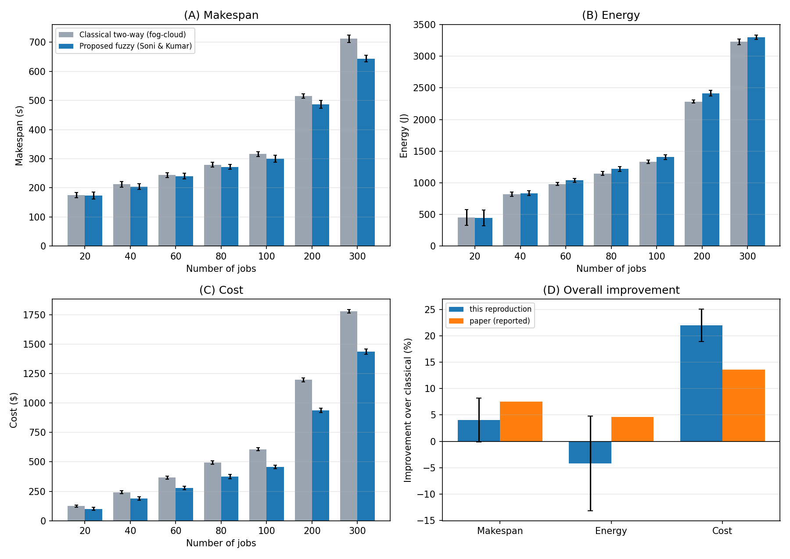

# Fuzzy Logic-Based Computation Offloading in Fog Computing — Reproduction & Type-2 Extension

> Fuzzy Logic course term project. **Status: work in progress.**

## Student Information
- GitHub: [@pinarlizeynep](https://github.com/pinarlizeynep)
- Course: Bulanık Mantık (Fuzzy Logic), Fall 2026

## Original Paper
D. Soni and N. Kumar, "Fuzzy logic-based computation offloading technique in fog computing,"
*Concurrency and Computation: Practice and Experience*, vol. 36, no. 20, p. e8198, 2024,
doi: [10.1002/cpe.8198](https://doi.org/10.1002/cpe.8198).

## Problem Description
IoT devices generate workflow jobs that must be executed on one of three computing layers —
**edge**, **fog**, or **cloud**. The choice affects makespan, energy consumption and monetary cost,
and it must be made under uncertain, rapidly changing conditions (load, latency, bandwidth, deadlines).
The reference paper uses a Mamdani fuzzy inference system to make this offloading decision.

## Project Scope
1. **Reproduction** — Python re-implementation of the paper's 5-input Mamdani FIS
   (job list size, VM utilization, network latency, bandwidth, deadline → edge/fog/cloud)
   inside a lightweight workflow simulator modelled on the paper's FogWorkflowSim settings
   (MONTAGE-like workflows, MIN-MIN scheduling, 20–300 jobs).
2. **Proposed extension** — Interval Type-2 fuzzy offloading and a noise/robustness analysis,
   plus a Mamdani-vs-Sugeno / defuzzification ablation.

## Repository Structure
```
src/            fuzzy/ engine, env/ nodes, workflow/ generator, scheduler/ MIN-MIN, policies/
data/           generated workflows and random seeds
experiments/    baseline/ and proposed/ experiment scripts
results/        figures/ and tables/
demo/           live demo
tests/          unit tests
docs/           project plan and paper analysis (Turkish)
report/         technical report (PDF)
presentation/   slides (PDF)
references/     bibliography
```

## Installation
```bash
git clone https://github.com/pinarlizeynep/bulanikMantik.git
cd bulanikMantik
py -3.12 -m venv .venv
.venv\Scripts\activate        # Windows  (Linux/macOS: source .venv/bin/activate)
pip install -r requirements.txt
```

## Requirements
Python 3.12 — see [`requirements.txt`](requirements.txt) for pinned library versions.

## Fuzzy System Architecture
Mamdani FIS implemented from scratch in [`src/fuzzy/`](src/fuzzy) and cross-checked against scikit-fuzzy.

| Variable | Universe | Terms (MFs read from the paper's Fig. 3) |
|---|---|---|
| Job list size `jl` | [0, 40] | Small `trap(0,0,8,16)`, Medium `tri(8,24,40)`, Large `trap(32,38,40,40)` |
| VM utilization `vt` | [0, 200] | Poor `trap(0,0,40,80)`, Medium `tri(40,120,200)`, Heavy `trap(160,180,200,200)` |
| Network latency `nl` | [0, 30] | Low `trap(0,0,4,8)`, Average `tri(4,17,30)`, High `trap(20,28,30,30)` |
| Bandwidth `bw` | [0, 20] | Low `trap(0,0,4,8)`, Average `tri(4,12,20)`, High `trap(16,18,20,20)` |
| Deadline `dl` | [0, 50] | Low `trap(0,0,10,20)`, Medium `tri(10,30,50)`, High `trap(40,48,50,50)` |
| **Decision** (output) | [0, 200] | Edge `tri(0,40,80)`, Fog `tri(40,100,160)`, Cloud `tri(120,160,200)` |

- **Inference:** AND = min, implication = min, aggregation = max, defuzzification = centroid (COG).
- **Decision thresholds:** crisp < 60 → Edge, 60–140 → Fog, > 140 → Cloud.
- **Rule base:** all 3⁵ = 243 rules are generated by a term-scoring scheme
  ([`paper_fis.py`](src/fuzzy/paper_fis.py)). The paper publishes only 3 example rules; the scheme
  reproduces all three of them.


## How to Run
```bash
# explain a single offloading decision (fuzzification -> fired rules -> defuzzification)
python -m src.fuzzy.paper_fis --jl 10 --vt 50 --nl 25 --bw 3 --dl 8

# membership-function figure, control surfaces, decision statistics
python -m experiments.fis_analysis

# baseline experiment: 20-300 jobs x 10 seeds x 5 policies
python -m experiments.baseline.run_baseline

# reproduction of the paper's Fig. 4 (proposed vs. classical) and Table 4 (QoS preferences)
python -m experiments.proposed.reproduce_fig4
python -m experiments.proposed.reproduce_table4

# unit tests (includes a cross-check against scikit-fuzzy)
python -m pytest
```

## Simulator
FogWorkflowSim (Java) is replaced by a small Python simulator so that the paper's method and the
baseline run on **identical** workflows, nodes and network.

| Module | Content |
|---|---|
| [`src/env`](src/env) | Edge / fog / cloud nodes with the paper's Table 3 parameters (2 nodes per layer by default), network transfer model |
| [`src/workflow`](src/workflow) | Seeded MONTAGE-like DAG generator with exactly *N* tasks (Montage_25 = 5 mProjectPP + 9 mDiffFit, as in Pegasus) |
| [`src/scheduler`](src/scheduler) | MIN-MIN list scheduling; the offloading policy picks the layer when a task becomes ready, MIN-MIN picks the node. Metrics: makespan (Eq. 12), energy (busy + idle power), cost (execution + communication), deadline miss rate |
| [`src/policies`](src/policies) | Proposed fuzzy offloading (Algorithms 1-5), baseline two-way fog-cloud offloading (Khan et al. 2023), single-layer and all-layer MIN-MIN reference policies |

Assumptions the paper leaves open (units, pricing, latency per layer) are documented in
[`src/env/nodes.py`](src/env/nodes.py). Energy counts idle power only for nodes that executed at
least one task (`simulate(..., idle="used")`; `idle="all"` keeps every node powered on).

## Reproduction Experiments
**Baseline** (classical two-way fog-cloud offloading), mean of 10 seeds — full table in
[`results/tables/baseline_summary.csv`](results/tables/baseline_summary.csv):

| Jobs | Makespan (s) | Energy (J) | Cost ($) | Cloud share |
|---|---|---|---|---|
| 20 | 174 | 412 | 120 | 8.5 % |
| 100 | 317 | 1334 | 609 | 49.7 % |
| 300 | 717 | 3240 | 1792 | 53.6 % |


**Proposed fuzzy offloading vs. baseline** (Fig. 4 reproduction, 7 job counts x 10 seeds, balanced QoS
preference, paired runs on identical workflows; positive = proposed is better):

| Metric | Improvement, mean ± std | Runs where proposed wins | Paper (reported) |
|---|---|---|---|
| Makespan | +4.1 ± 4.2 % | 79 % | 7.51 % |
| Energy | −4.2 ± 9.0 % (worse) | 10 % | 4.63 % |
| Cost | +22.0 ± 3.1 % | 100 % | 13.60 % |



The makespan and cost gains are reproduced in direction; the energy gain is **not** (details and
the reason in [`docs/gunluk/gun4_2026-11-10.md`](docs/gunluk/gun4_2026-11-10.md)).

**QoS preferences (Table 4 reproduction).** With the published layer mapping (cost→cloud, energy→fog,
time→edge) the trends of the paper's Table 4 are not reproduced: edge-only execution is the *cheapest
and most frugal* but slowest, a cloud-heavy mix is the *fastest* but most expensive — the opposite of
the paper's labels, because the paper's own Table 3 makes the cloud fast but expensive and the edge
free but slow. A sensitivity run with the physically consistent mapping is in
[`results/figures/table4_physical_mapping.png`](results/figures/table4_physical_mapping.png).


## Proposed Extension
_To be added._

## Experimental Results
_To be added._

## Limitations
_To be added._

## References
See [`references/README.md`](references/README.md).
