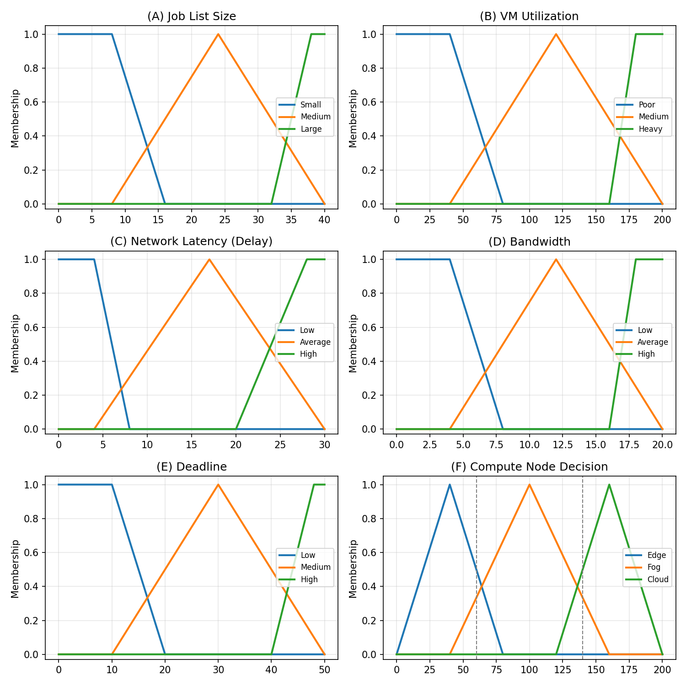

# Fuzzy Logic-Based Computation Offloading in Fog Computing — Reproduction & Type-2 Extension

> Fuzzy Logic course term project. **Status: work in progress.**

## Student Information
- GitHub: [@pinarlizeynep](https://github.com/pinarlizeynep)
- Course: Bulanık Mantık (Fuzzy Logic), Fall 2026

## Original Paper
D. Soni and N. Kumar, "Fuzzy logic-based computation offloading technique in fog computing,"
*Concurrency and Computation: Practice and Experience*, vol. 36, no. 20, p. e8198, 2024,
doi: [10.1002/cpe.8198](https://doi.org/10.1002/cpe.8198).

## Problem Description
IoT devices generate workflow jobs that must be executed on one of three computing layers —
**edge**, **fog**, or **cloud**. The choice affects makespan, energy consumption and monetary cost,
and it must be made under uncertain, rapidly changing conditions (load, latency, bandwidth, deadlines).
The reference paper uses a Mamdani fuzzy inference system to make this offloading decision.

## Project Scope
1. **Reproduction** — Python re-implementation of the paper's 5-input Mamdani FIS
   (job list size, VM utilization, network latency, bandwidth, deadline → edge/fog/cloud)
   inside a lightweight workflow simulator modelled on the paper's FogWorkflowSim settings
   (MONTAGE-like workflows, MIN-MIN scheduling, 20–300 jobs).
2. **Proposed extension** — Interval Type-2 fuzzy offloading and a noise/robustness analysis,
   plus a Mamdani-vs-Sugeno / defuzzification ablation.

## Repository Structure
```
src/            fuzzy engine, environment model, workflow generator, scheduler, policies
data/           generated workflows and random seeds
experiments/    baseline/ and proposed/ experiment scripts
results/        figures/ and tables/
demo/           live demo
tests/          unit tests
docs/           project plan and paper analysis (Turkish)
report/         technical report (PDF)
presentation/   slides (PDF)
references/     bibliography
```

## Installation
```bash
git clone https://github.com/pinarlizeynep/bulanikMantik.git
cd bulanikMantik
py -3.12 -m venv .venv
.venv\Scripts\activate        # Windows  (Linux/macOS: source .venv/bin/activate)
pip install -r requirements.txt
```

## Requirements
Python 3.12 — see [`requirements.txt`](requirements.txt) for pinned library versions.

## Fuzzy System Architecture
Mamdani FIS implemented from scratch in [`src/fuzzy/`](src/fuzzy) and cross-checked against scikit-fuzzy.

| Variable | Universe | Terms (MFs read from the paper's Fig. 3) |
|---|---|---|
| Job list size `jl` | [0, 40] | Small `trap(0,0,8,16)`, Medium `tri(8,24,40)`, Large `trap(32,38,40,40)` |
| VM utilization `vt` | [0, 200] | Poor `trap(0,0,40,80)`, Medium `tri(40,120,200)`, Heavy `trap(160,180,200,200)` |
| Network latency `nl` | [0, 30] | Low `trap(0,0,4,8)`, Average `tri(4,17,30)`, High `trap(20,28,30,30)` |
| Bandwidth `bw` | [0, 20] | Low `trap(0,0,4,8)`, Average `tri(4,12,20)`, High `trap(16,18,20,20)` |
| Deadline `dl` | [0, 50] | Low `trap(0,0,10,20)`, Medium `tri(10,30,50)`, High `trap(40,48,50,50)` |
| **Decision** (output) | [0, 200] | Edge `tri(0,40,80)`, Fog `tri(40,100,160)`, Cloud `tri(120,160,200)` |

- **Inference:** AND = min, implication = min, aggregation = max, defuzzification = centroid (COG).
- **Decision thresholds:** crisp < 60 → Edge, 60–140 → Fog, > 140 → Cloud.
- **Rule base:** all 3⁵ = 243 rules are generated by a term-scoring scheme
  ([`paper_fis.py`](src/fuzzy/paper_fis.py)). The paper publishes only 3 example rules; the scheme
  reproduces all three of them.



## How to Run
```bash
# explain a single offloading decision (fuzzification -> fired rules -> defuzzification)
python -m src.fuzzy.paper_fis --jl 10 --vt 50 --nl 25 --bw 3 --dl 8

# membership-function figure, control surfaces, decision statistics
python -m experiments.fis_analysis

# unit tests (includes a cross-check against scikit-fuzzy)
python -m pytest
```

## Reproduction Experiments
_To be added._

## Proposed Extension
_To be added._

## Experimental Results
_To be added._

## Limitations
_To be added._

## References
See [`references/README.md`](references/README.md).
