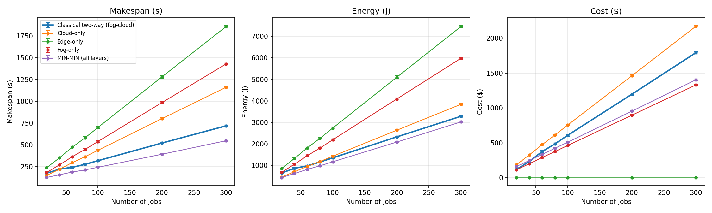

# 3. Gün — 9 Kasım 2026 (Pazartesi): Simülatör ve Baseline

> **Düzeltme (4. gün):** Bu günlükteki enerji rakamları, kullanılmayan düğümlerin boşta gücünü de sayan ilk enerji modeline aittir. 4. günde model düzeltildi: yalnızca iş çalıştıran düğümler boşta güç harcar. Güncel rakamlar `results/tables/baseline_summary.csv` ve README'dedir (baseline enerjisi: 20 iş 412 J, 100 iş 1334 J, 300 iş 3240 J). Aşağıdaki "Edge-only en çok enerjiyi harcıyor" yorumu **artık geçerli değil**; ayrıntı `gun4` günlüğünde.

**Checkpoint:** CP3 — Baseline yeniden üretimi
**Commitler:** `Fix review findings in fuzzy engine and pin dependencies`, `Add fog/cloud/edge environment model, MONTAGE workflow and MIN-MIN scheduler`, `Add baseline two-way offloading`

---

## Bugün ne yaptık? (özet)
1. Dünkü kod incelemesinde çıkan **10 bulguyu düzelttik**. Bulanık motor artık hatalı girdiyi reddediyor ve ~7 kat daha hızlı.
2. Makalenin FogWorkflowSim (Java) ortamının yerine geçen **kendi Python simülatörümüzü** yazdık:
   - **Ortam:** Tablo 3'teki edge/fog/cloud düğümleri ve aralarındaki ağ
   - **İş akışı:** MONTAGE benzeri iş akışı (DAG) üreteci
   - **Zamanlayıcı:** MIN-MIN
3. Makalenin karşılaştırdığı **baseline** yöntemi (Khan vd. 2023, fog–cloud arası iki yönlü offloading) **aynı simülatörde** yeniden kodladık ve 20–300 iş için, 10 tekrarla koştuk.

---

## 1. Kod incelemesi düzeltmeleri (`src/fuzzy/`)
| Bulgu | Sorun | Çözüm |
|---|---|---|
| NaN çıktı | Hiç kural ateşlenmezse sonuç NaN oluyordu ve iş sessizce **Fog**'a gidiyordu | `crisp_to_layer` artık hata veriyor |
| NaN girdi | `clip()` NaN'ı geçiriyordu | Sonlu olmayan girdi `ValueError` veriyor |
| Hız (2 bulgu) | 243 kural tek tek Python döngüsünde işleniyordu | Kurallar bir kez **indeks matrisine** derleniyor, ateşleme gücü tek numpy işlemiyle hesaplanıyor |
| Birleştirme | Her kural için ayrı kırpma yapılıyordu | Aynı sonuca sahip kurallardan yalnız en güçlüsü önemli, bu yüzden çıktı terimi başına **tek kırpma** (3 işlem) |
| Bulanıklaştırma | Her terim için gereksiz dizi oluşturuluyordu | Skaler `MF.degree()` |
| `Rule` | Hash'lenemiyordu | `__hash__` eklendi |
| `MamdaniFIS ==` | Hata veriyordu | Kimliğe göre karşılaştırma (`eq=False`) |
| Bağımlılıklar | Dolaylı paketler sabit değildi | `requirements.txt` artık tüm paketleri sürümüyle sabitliyor |
| Uyarı filtresi | pytest'teki filtre uyarının asıl kaynağını gizliyordu | Filtre kaldırıldı; asıl sebep olan `pyparsing` 3.2.3'e sabitlendi |
| Test kapsamı | scikit-fuzzy karşılaştırması yalnız centroid'i kapsıyordu | Artık **5 durulaştırma yönteminin hepsi** scikit-fuzzy ile karşılaştırılıyor |

Sonuçlar:
- Karar dağılımı **birebir aynı** kaldı (Edge %17.1 / Fog %81.75 / Cloud %1.15).
- Bir kararın süresi **0.319 ms'den 0.045 ms'ye** indi.

> **Savunmada sorulursa ("Neden birleştirmede kural başına değil, terim başına kırpıyorsunuz?"):** "Max-min birleştirmede aynı çıktı terimine (ör. Fog) giden kuralların kırptığı şekiller iç içedir. Kırpılmış şekillerin maksimumu, en güçlü kuralın kırptığı şekle eşittir. Sonuç matematiksel olarak aynı, işlem sayısı 243 yerine 3. Bunu `test_vectorized_firing_matches_naive_min` testi ve scikit-fuzzy karşılaştırması doğruluyor."

## 2. Neden kendi simülatörümüz?
Makale FogWorkflowSim (Java) kullanıyor. Biz Python'da yazdık:
- Bulanık sistemimiz Python'da. Tek dilde kalınca deneyler, testler ve canlı demo çok daha basit oluyor.
- **Adil karşılaştırma:** Makale baseline sonuçlarını başka bir çalışmadan ve başka bir simülatörden (SFogSim) almış görünüyor. Biz iki yöntemi **aynı iş akışı, aynı düğümler, aynı ağ** üzerinde koşuyoruz. Bu, makaleye yönelttiğimiz eleştirilerden birine doğrudan çözüm.
- Simülatör küçük. Her satırını açıklayabiliyoruz ve 300 işlik bir simülasyon ~0.02 s sürüyor.

## 3. Ortam modeli — `src/env/nodes.py`
Düğüm parametreleri makalenin **Tablo 3**'ünden alındı:

| Katman | MIPS | UpBw | DownBw | Çalışma gücü (mW) | Boşta güç (mW) | Görev fiyatı | İletişim fiyatı |
|---|---|---|---|---|---|---|---|
| Cloud | 1600 | 300 | 500 | 1600 | 1300 | 0.96 | 0.02 |
| Fog | 1300 | 500 | 800 | 800 | 40 | 0.48 | 0.01 |
| Edge | 1000 | 800 | 1000 | 700 | 30 | 0 | 0 |

Makalenin **vermediği** ama bizim belirlemek zorunda kaldığımız şeyler (raporda "varsayımlar" başlığı altında yazılacak):
- **Birimler:** Bant genişliği Mbit/s, veri MB. Aktarım süresi = `8 · MB / Mbps` saniye.
- **Fiyatlandırma:** Görev fiyatı çalışma saniyesi başına, iletişim fiyatı alınan MB başına uygulanıyor.
- **Gecikme:** Tek yön ağ gecikmesi edge 2 ms, fog 10 ms, cloud 30 ms. Bu değerler FIS'in gecikme evreni [0, 30] ms içinde.
- **Düğüm sayısı:** Her katmanda 2 düğüm (`default_environment(2, 2, 2)`).
- **Aktarım kuralları:**
  - Düğümler arası aktarım: `kaynak gecikme + hedef gecikme + 8·MB / min(kaynak UpBw, hedef DownBw)`
  - Aynı düğümde aktarım süresi 0.
  - Cihazdan düğüme yükleme hedefin UpBw değeriyle yapılıyor.

Tabloya göre her katmanın bir avantajı var:
- **Edge:** en hızlı bağlantı ve bedava, ama en yavaş işlemci.
- **Cloud:** en hızlı işlemci, ama en yavaş bağlantı, en pahalı ve boşta bile 1300 mW harcıyor.
- **Fog:** ikisinin arasında.

Bu gerilim offloading kararını anlamlı kılıyor.

## 4. MONTAGE iş akışı — `src/workflow/montage.py`
MONTAGE, gökyüzü görüntülerinden mozaik oluşturan gerçek bir bilimsel iş akışı (Pegasus). Yapısı katmanlı:

```
mProjectPP ×n  →  mDiffFit ×d  →  mConcatFit  →  mBgModel  →  mBackground ×n  →  mImgtbl  →  mAdd  →  mShrink  →  mJPEG
(giriş görevleri)  (2 ebeveyn)      (birleşim)                    (+ kendi mProjectPP'si)
```

- Toplam görev sayısı: `2n + d + 6`. N iş istenirse `n = round((N−6)/4)` ve `d = N − 2n − 6` seçiliyor; böylece **tam olarak N görev** oluşuyor.
- **Kontrol:** N = 25 için n = 5, d = 9 çıkıyor. Gerçek Pegasus Montage_25 ile aynı (testte doğrulanıyor).
- Görev süreleri gerçek MONTAGE izlerindeki tür ortalamalarına yakın (ör. mProjectPP ~13 s, mAdd ~60 s, 1000 MIPS'te). Her görev ±%20 rastgele sapmayla, **tohumlu (seed)** olarak üretiliyor. Aynı seed her zaman aynı iş akışını verir.
- **Deadline:** Her göreve bir süre payı (slack) atanıyor: `U(1.2, 4) × referans süre`, en fazla 50 s. Bu sınır FIS'in deadline evreni [0, 50] ile uyumlu.

## 5. MIN-MIN zamanlayıcı — `src/scheduler/minmin.py`
1. Bir görevin tüm ebeveynleri zamanlandığında görev **hazır** olur. Tam o anda **offloading politikasına bir kez** sorulur: "Bu görev hangi katmanda çalışabilir?"
   - Makaledeki yapı da böyle: karar mekanizması katmanı seçer, MIN-MIN o katmanın içinde zamanlar.
2. **MIN-MIN turu:** Hazır görevlerin her biri için, izin verilen her düğümde en erken bitiş zamanı hesaplanır:
   - `EFT = max(düğüm boş zamanı, veri hazır zamanı) + uzunluk / MIPS`
   - **En küçük EFT'ye sahip (görev, düğüm) çifti** seçilir ve atanır.
3. Tüm görevler bitene kadar tekrar edilir.

**Metrikler** (makale Bölüm 2.1):
- **Makespan** = son bitiş − ilk başlangıç (Denklem 12)
- **Enerji** = her düğüm için `meşgul süre × P_çalışma + boş süre × P_boşta` [J]
- **Maliyet** = her görev için `çalışma süresi × görev fiyatı + alınan MB × iletişim fiyatı`
- **Ek metrik (makalede yok):** deadline kaçırma oranı

## 6. Baseline — `src/policies/baseline.py`
Klasik iki yönlü fog–cloud offloading (Khan vd. 2023). Edge çalıştırma hedefi olarak kullanılmıyor. Hazır olan her görev için:
1. **Önce fog:** En iyi fog düğümü işi deadline'a kadar bitirebiliyorsa → **Fog**
2. **Yukarı (fog → cloud):** Yetmiyorsa ve cloud deadline'ı karşılıyorsa → **Cloud**
3. İkisi de karşılayamıyorsa → hangisi daha erken bitiriyorsa
4. **Aşağı (cloud → fog):** Fog'da yer açıldığı anda işler tekrar fog'da tutuluyor. "İki yönlü" ifadesi buradan geliyor.

**Bulduğumuz bir tuzak:** İlk sürümde baseline neredeyse **hiç cloud kullanmadı** (%100 fog).
- **Sebep:** Karar anında, fog'a gönderilmiş ama henüz zamanlanmamış işler hiçbir düğümü işgal etmiyordu. Bu yüzden fog hep boş görünüyordu.
- **Çözüm:** Zamanlayıcı her katman için **bekleyen iş yükünü** (MI) tutuyor. Politika `expected_eft = en iyi EFT + bekleyen iş / katman kapasitesi` ile karar veriyor.
- Bu düzeltmeden sonra baseline yük arttıkça işleri cloud'a taşırıyor: 20 işte %8 cloud, 300 işte %54 cloud.

> **Savunmada sorulursa:** "Bekleyen iş yükü bilgisi 4. günde bulanık sistemin **VM kullanımı (vt)** girdisini hesaplamak için de kullanılacak."

## 7. Referans politikalar — `src/policies/base.py`
- **Edge-only / Fog-only / Cloud-only:** Tüm işler tek katmana gidiyor. Makaledeki tek amaçlı algoritmalara karşılık geliyor (Alg. 4 / 3 / 2) ve ortamın uç değerlerini gösteriyor.
- **MIN-MIN (tüm katmanlar):** Hiç offloading mantığı yok. MIN-MIN altı düğümün hepsi arasında serbestçe seçiyor. Güçlü bir makespan referansı, ama makalenin yöntemi değil.

## 8. Sonuçlar (10 seed, ortalama) — `results/tables/baseline_summary.csv`
| Politika | İş | Makespan (s) | Enerji (J) | Maliyet ($) | Cloud payı |
|---|---|---|---|---|---|
| Baseline (two-way) | 20 | 174 | 650 | 120 | %8.5 |
| Baseline (two-way) | 100 | 317 | 1353 | 609 | %49.7 |
| Baseline (two-way) | 300 | 717 | 3283 | 1792 | %53.6 |
| MIN-MIN (tümü) | 300 | 546 | 3022 | 1404 | %43.5 |
| Edge-only | 300 | 1856 | 7459 | 0 | %0 |
| Cloud-only | 300 | 1159 | 3841 | 2170 | %100 |



**Yorumlar:**
- Üç metrik de iş sayısıyla yaklaşık doğrusal artıyor. Bu, makalenin Şekil 4A–C eğrileriyle aynı eğilim.
- **Mutlak değerler makaleyle aynı değil**, çünkü birimler ve iş boyutları farklı. Biz **göreli iyileşmeyi** (%) karşılaştıracağız.
- **Edge-only en çok enerjiyi harcıyor.** Sebebi şu: makespan uzayınca, kullanılmayan cloud düğümleri 1300 mW boşta güç çekmeye devam ediyor. Enerji modelinde boşta güç belirleyici. Bu, 4. günde makalenin Tablo 4'ündeki "enerji önceliği → Edge" iddiasını değerlendirirken önemli olacak.
- Tüm katmanları kullanan MIN-MIN, baseline'dan daha iyi. Yani edge'i hiç kullanmamak baseline'ın zayıf noktası. Bulanık politikanın kazanç sağlayabileceği alan da tam burası.

## 9. Testler — `tests/test_simulator.py` (17 test)
- **Elle hesaplanabilen zincir:** a → b tek edge düğümünde. Başlangıç, bitiş, makespan, enerji ve maliyet kalemle hesaplanıp kodla karşılaştırılıyor.
- **Her politika için şu kurallar kontrol ediliyor:**
  - Hiçbir görev ebeveyni bitmeden başlamıyor.
  - Bir düğümde iki görev çakışmıyor.
  - Katman payları toplamı 1.
- MONTAGE yapısı (Montage_25 = 5 + 9), seed tekrar üretilebilirliği, baseline'ın yük altında cloud kullanması.
- Toplamda **39 test** var ve hepsi geçiyor.

## Canlı demo komutları
```bash
python -m experiments.baseline.run_baseline          # 7 iş sayısı × 10 seed × 5 politika, ~10 s
python -m pytest tests/test_simulator.py -v
```

## Yarın (4. gün)
- **Bulanık offloading politikası:** Simülatörün gözlemlerini FIS'in 5 girdisine dönüştürmek:
  - `jl` ← hazır kuyruk uzunluğu
  - `vt` ← katman doluluğu
  - `nl` ← gecikme
  - `bw` ← bant genişliği
  - `dl` ← deadline payı
- Makalenin Şekil 4 ve Tablo 4'ünü yeniden üretmek ve baseline ile göreli iyileşmeyi hesaplamak.
