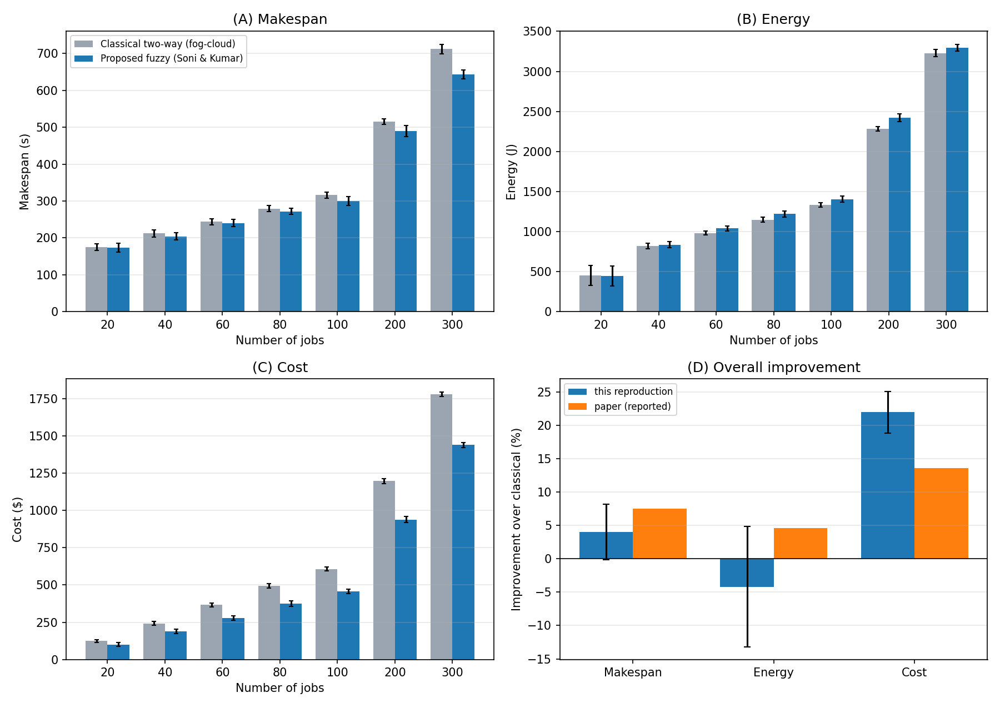
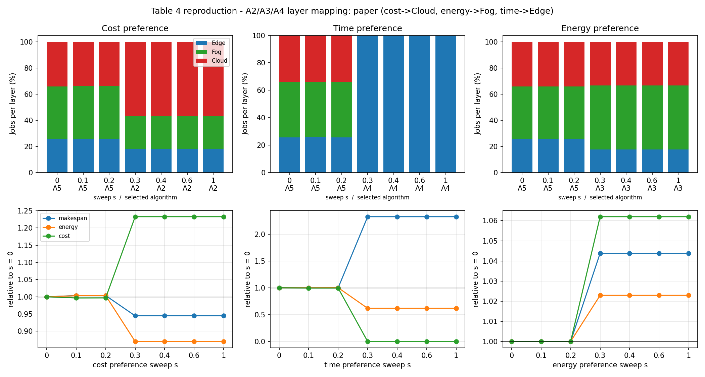

# 4. Gün — 10 Kasım 2026 (Salı): Bulanık Offloading Politikası, Şekil 4 ve Tablo 4

**Checkpoint:** CP3 — Makalenin yeniden üretimi
**Commitler:** `Count idle power only for used nodes and expose layer load`, `Add fuzzy offloading policy with QoS algorithm selection`, `Reproduce Fig.4 and Table 4`

---

## Bugün ne yaptık? (özet)
1. Dünkü simülatörde bir **enerji modeli hatası** bulup düzelttik (kullanılmayan düğümlerin boşta gücü sayılıyordu).
2. Makalenin **Algoritma 1–5** yapısını kodladık: kullanıcının QoS tercihi → Tablo 2'deki 16 kural → A2 / A3 / A4 / A5 seçimi. A5'te 5 girdili bulanık sistem (dünkü motor) iş başına karar veriyor.
3. Simülatörün durumunu FIS'in 5 girdisine çeviren **gözlem eşlemesini** tasarladık.
4. **Şekil 4'ü** (önerilen yöntem ile klasik yöntem, 20–300 iş, 10 tekrar) ve **Tablo 4'ü** (QoS tercihine göre katman dağılımı) yeniden ürettik.
5. Makalenin kendi içinde **tutarsız** olduğunu sayılarla gösteren bir bulgu çıkardık.

> **En önemli sonuç (savunmada bunu anlat):** Önerilen yöntemin makespan ve maliyet kazancı yön olarak yeniden üretildi, **enerji kazancı üretilemedi**. Tablo 4'ün eğilimleri de makalenin etiketleriyle **ters** çıktı. İkisinin de nedenini ölçerek bulduk.

---

## 1. Enerji modeli düzeltmesi — `src/scheduler/minmin.py`
**Sorun:** Dün enerjiyi, ortamdaki **her** düğümün boşta gücünü makespan boyunca toplayarak hesaplıyorduk. Sonuç: tüm işleri Edge'te çalıştıran politika, hiç kullanmadığı cloud düğümlerinin 1300 mW boşta gücü yüzünden **en çok** enerjiyi harcıyor görünüyordu. Bu mantıksız. Kullanılmayan düğüm kapalıdır.

**Çözüm:** Yalnızca **en az bir iş çalıştıran** düğümler boşta güç harcar (`simulate(..., idle="used")`, varsayılan). Eski davranış `idle="all"` ile duruyor. 6. günde ablation'da kullanabiliriz.

**Doğrulama:** Düzeltmeden sonra tek katmanlı politikaların enerji sırası, Tablo 3'teki **mW/MIPS** oranıyla örtüşüyor:

| Katman | Güç / MIPS | Anlamı |
|---|---|---|
| Fog | 800 / 1300 = **0.615** | en verimli |
| Edge | 700 / 1000 = 0.700 | |
| Cloud | 1600 / 1600 = 1.000 | en savurgan |

100 işte Fog-only 766 J, Edge-only 870 J, Cloud-only 1366 J. Bu, makalenin Algoritma 3'ünün "enerji → Fog" seçimiyle de uyumlu. Bunu `test_energy_ranking_follows_table3_power_per_mips` testi güvence altına alıyor.

Ayrıca bir **"offloading süresi"** metriği ekledik: bir görevin hazır olduktan sonra girdi verisini beklediği süre (Tablo 4'ün son sütunu).

## 2. İki katmanlı karar yapısı — `src/fuzzy/qos_selector.py`
Makalede **iki ayrı** bulanık sistem var. Dün yalnızca ikincisini yazmıştık:

| Katman | Girdi | Çıktı | Dosya |
|---|---|---|---|
| **1. QoS seçici** (Tablo 2, Alg. 1) | Kullanıcı tercihi: zaman T, enerji E, maliyet C ∈ [0,1] | Hangi algoritma: A2, A3, A4 veya A5 | `qos_selector.py` |
| **2. Offloading FIS'i** (Alg. 5) | jl, vt, nl, bw, dl | Karar ∈ [0,200] → Edge/Fog/Cloud | `paper_fis.py` |

- Her tercih derecesi Low / Medium / High'a bulanıklaştırılıyor. Makale kümelerin desteklerini veriyor: L = (0, 0.5], M = [0.2, 0.8], H = [0.5, 1]. Biçimi vermiyor, biz **sol omuz / üçgen / sağ omuz** seçtik.
- 16 kural makaledeki Tablo 2'den birebir alındı. Kural gücü = üç koşulun **min**'i. Her algoritma için en güçlü kural alınıyor, en güçlü algoritma kazanıyor.
- **Makalenin boşluğu:** Tablo 2 her kombinasyonu kapsamıyor. Örneğin dengeli tercih (T = E = C = 1/3) için hiçbir kural ateşlenmiyor. Bu durumda **A5 (hibrit)** kullanıyoruz.

| Tercih (T, E, C) | Seçilen algoritma | Katman |
|---|---|---|
| (1, 0, 0) saf zaman | A4 | Edge |
| (0, 1, 0) saf enerji | A3 | Fog |
| (0, 0, 1) saf maliyet | A2 | Cloud |
| (1/3, 1/3, 1/3) dengeli | A5 | FIS karar verir |

## 3. Bulanık politika — `src/policies/fuzzy_policy.py`
Bir görev hazır olduğunda:
1. Tercihten algoritma seçilir (A2/A3/A4 ise katman sabit).
2. **A5 ise:** simülatör durumu 5 girdiye çevrilir → FIS (centroid) → crisp değer `C`.
3. **QoS ağırlığı:** Her tercih, crisp değeri kendi saf algoritmasının katmanına doğru iter (Edge = −1, Fog = 0, Cloud = +1 yönü). Makalenin eşlemesiyle bu `C' = C + 40·(maliyet − zaman)/(T+E+C)` olur: maliyet Cloud'a, zaman Edge'e doğru. Fiziksel eşlemede yön kendiliğinden ters döner, böylece hibrit bölge ile saf algoritmalar hep aynı yöne bakar. Dengeli tercihte kayma **sıfır**, yani saf FIS çalışır.
4. `C' < 60` Edge, 60–140 Fog, > 140 Cloud.
5. **Teklif edilen katman deadline'ı kaçıracaksa** ve başka bir katman kaçırmıyorsa, en erken bitiren katman seçilir. Bu, Alg. 5'teki "(dl not met)" kontrolü. Saf algoritma Edge'i seçtiyse bu **yerel çalıştırmadır**, offloading değildir, kontrol edilmez (Alg. 2–4: "koşul sağlanmazsa iş yerelde çalışır"). Bu yüzden A2/A3 işlerin **çoğunu** (hepsini değil) hedef katmana gönderir. `verify_deadline=False` ile kapatılabiliyor (6. gün ablation'ı için).
6. Katman içindeki düğümü yine MIN-MIN seçer.

### 5 girdinin eşlemesi (`observe`) — savunmada en çok sorulacak kısım
Makale girdilerin adını veriyor ama **nasıl ölçüldüğünü vermiyor**. Eşlememiz bizim tasarımımız. Makalenin min-max normalizasyonu (Denk. 23) ruhunda: ham büyüklük bir referansa bölünüp değişkenin evrenine ölçekleniyor.

| Girdi | Evren | Biz nasıl ölçtük |
|---|---|---|
| `jl` iş listesi | [0,40] | Hazır kuyruktaki görev sayısı, 40'a kırpılır |
| `vt` VM kullanımı | [0,200] | Yerel katmanın (Edge + Fog) yükü: düğüm kuyruğu **artı henüz zamanlanmamış bekleyen iş**, 60 saniyelik referansa oranı, yüzde olarak. 100 = referans kadar yük, 200 = iki katı |
| `nl` ağ gecikmesi | [0,30] | Verinin Cloud'a ulaşması ile Fog'a ulaşması arasındaki **fark**, 0.25 s referansa oranlanıp 30'a ölçeklenir |
| `bw` bant genişliği | [0,20] | Görevin verisini en iyi Cloud düğümüne taşıyacak bağlantının hızı (simülatördeki gibi `min(kaynak up, hedef down)`; giriş görevlerinde cihazdan yükleme), Tablo 3'teki en hızlı etkin bağlantıya (Edge uplink, 800 Mbit/s) oranı |
| `dl` deadline | [0,50] | Görevin süre payı (saniye), zaten evren içinde |

**Ölçek sabitleri nasıl seçildi:** `vt_ref_s = 60` ve `nl_ref_s = 0.25` değerlerini, girdilerin evrenlerin tamamını kullanması için yalnızca **girdi dağılımlarına bakarak** ayarladık. İlk denemede `vt` hep 0, sonra hep 200 çıkıyordu. Ayarı **0–2 numaralı seed'lerle** yaptık. Deneyler **100–109 numaralı seed'lerle** koştu. Böylece sonuç metriklerine bakarak ayar yapmış olmadık. `test_inputs_use_a_wide_part_of_each_universe` bu bozulmayı yakalıyor.

**Tuzak (dünkü baseline'dakiyle aynı):** `vt` başta hep 0 çıktı. Karar anında görevler henüz düğüme atanmadığı için kuyruk boş görünüyordu. Bekleyen iş yükü eklenince düzeldi.

**Dürüst sınırlama:** Tablo 3 ortamında bant genişliği statik olduğu için `bw` pratikte yalnızca üç değer alıyor (7.5: cihazdan yükleme, 12.5: Edge/Fog'dan aktarım, 20: veri zaten Cloud düğümünde). `nl` de dar bir aralıkta değişiyor. Yani FIS kararlarını ağırlıklı olarak `jl`, `vt` ve `dl` yönlendiriyor. `nl` ve `bw` 5. gündeki **gürültü deneylerinde** önem kazanacak, çünkü onları bozacağız.

## 4. Şekil 4'ün yeniden üretimi — `experiments/proposed/reproduce_fig4.py`
Dengeli tercih, 7 iş sayısı × 10 seed, **aynı iş akışı** üzerinde eşli karşılaştırma. Pozitif = önerilen yöntem daha iyi.

| Metrik | İyileşme (ort. ± std) | Önerilenin kazandığı koşu | p-değeri | Makale (metinde) |
|---|---|---|---|---|
| Makespan | **+%4.03 ± 4.16** | %79 | 1.4e-11 | %7.51 |
| Enerji | **−%4.18 ± 8.99** (kötü) | %10 | 2.2e-4 | %4.63 |
| Maliyet | **+%21.94 ± 3.09** | %100 | 6e-61 | %13.60 |



100 iş için ortalamalar:

| | Makespan (s) | Enerji (J) | Maliyet ($) | Deadline kaçırma | Edge / Fog / Cloud payı |
|---|---|---|---|---|---|
| Klasik | 316.0 | 1331 | 608 | %27.2 | %0 / %50 / %50 |
| Önerilen | 300.2 | 1406 | 459 | %22.0 | %26 / %40 / %34 |

**Yorumlar:**
- **Maliyet kazancı büyük ve tutarlı.** Sebep açık: önerilen yöntem işlerin %26'sını **bedava** olan Edge'e gönderiyor, Cloud payı %50'den %34'e düşüyor. Klasik yöntem Edge'i hiç kullanmıyor.
- **Makespan** kazancı küçük ama istatistiksel olarak anlamlı. Yükün arttığı 300 işte en belirgin (%9.6: 712 s → 644 s).
- **Enerji neden kötü?** Tahmin etmek yerine ölçtük (100 iş, 10 seed ortalaması):

| | Çalışma enerjisi (J) | Cloud boşta enerjisi (J) |
|---|---|---|
| Klasik | 990 | 336 |
| Önerilen | **939** (%5 az) | **450** (+114) |

  Önerilen yöntemin **çalışma enerjisi daha düşük**: iş yükünü daha verimli katmanlara dağıtıyor. Ama Cloud'a az iş gönderdiği için Cloud düğümleri **açık ve boşta** (1300 mW) kalıyor, ve boşta güç makespan boyunca sayılıyor. Yani kayıp, **boşta güç muhasebesinin bir sonucu**. Makalenin %4.63'lük enerji kazancı büyük ihtimalle çalışma enerjisi yönünde bir ölçüm. Makale enerjiyi nasıl topladığını yazmıyor.
- **Makalenin sayıları arasında tutarsızlık:** Şekil 4A–C çubuklarından okuduğumuz değerlerden hesaplanan ortalama iyileşme (%14.9 / %9.7 / %19.5), metinde yazan %7.51 / %4.63 / %13.60 ile örtüşmüyor. Bunu daha önce Şekil 4E için de fark etmiştik.

## 5. Tablo 4'ün yeniden üretimi — `experiments/proposed/reproduce_table4.py`
Makale hangi tercih derecelerini kullandığını vermiyor. Biz dengeli tercihten saf tercihe doğru bir **tarama** yaptık: `tercih(s) = (1−s)·(1/3,1/3,1/3) + s·e_k`, s = 0 … 1, 100 iş, 10 seed.



Makalenin yayımlanan etiketleriyle (maliyet→Cloud, enerji→Fog, zaman→Edge), 100 işte:

| Tercih | Algoritma | Cloud / Fog / Edge (%) | Makespan (s) | Enerji (J) | Maliyet ($) |
|---|---|---|---|---|---|
| Dengeli (s=0) | A5 | 34 / 40 / 26 | 300 | 1406 | 459 |
| Saf **maliyet** | A2 | 57 / 25 / 18 | **284** (en hızlı) | 1223 | **565** (daha pahalı) |
| Saf **zaman** | A4 | 0 / 0 / **100** | **698** (en yavaş) | **869** | **0** |
| Saf **enerji** | A3 | 33 / 49 / 18 | 313 | 1438 | 487 |

### Bulgu: makalenin etiketleri kendi Tablo 3'üyle çelişiyor
- **Maliyet tercihi → Cloud** dediğimizde maliyet **düşmüyor, artıyor** (459 → 565 $). Tablo 3'e göre Cloud en pahalı katman. Makalenin Tablo 4'ünde ise Cloud payı arttıkça maliyet 1361 $'dan 181 $'a **düşüyor**. Bu, Tablo 3'ün fiyatlarıyla bağdaşmıyor.
- **Zaman tercihi → Edge** dediğimizde makespan **2.3 kat kötüleşiyor**, çünkü Edge en yavaş işlemci. Makalenin Tablo 4'ünde ise zaman tercihi Fog ağırlıklı ve makespan en düşük.
- Makalenin **kendi içinde** de tutarsızlık var: Algoritma 3–4 "enerji → Fog, zaman → Edge" diyor, Tablo 4 ise enerji tercihinde Edge payını, zaman tercihinde Fog payını artırıyor.

**Duyarlılık analizi:** Fiziksel olarak tutarlı eşlemeyle (maliyet→Edge, enerji→Fog, zaman→Cloud) yeniden koştuk (`PHYSICAL_LAYER`, `table4_physical_mapping.png`). Sayılar yer değiştiriyor: zaman tercihi → makespan 284 s (en hızlı), maliyet tercihi → maliyet 0 $. Hibrit bölgedeki QoS kayması da eşlemeye göre yön değiştiriyor, bu yüzden iki eşleme birbirinin tam ayna görüntüsü (fiziksel maliyet taraması = makaledeki zaman taraması). Yani sorun uygulamamızda değil, **etiketlerde**.

> **Savunmada sorulursa ("Tablo 4'ü neden yeniden üretemediniz?"):** "Makalenin Algoritma 2–4'teki katman etiketleri, kendi Tablo 3'ündeki parametrelerle çelişiyor. Cloud en hızlı ama en pahalı, Edge en yavaş ama bedava. Etiketleri makaledeki gibi uyguladığımızda maliyet tercihi maliyeti artırıyor, zaman tercihi makespan'ı 2.3 kat kötüleştiriyor. Etiketleri fiziksel olarak tutarlı hale getirdiğimizde beklenen eğilim ortaya çıkıyor. Bu duyarlılık analizini raporda sunuyorum."

### Tarama neden iki basamaklı?
Grafikte s = 0.3'ten sonra sonuçlar değişmiyor. Sebep: Tablo 2'deki saf-algoritma kuralları kolayca ateşleniyor (örneğin s = 0.3'te zaman tercihi 0.53 olunca R7 "H L L" devreye giriyor) ve A2/A3/A4 **hedef katmanı sabitliyor** (yalnızca deadline kontrolü tek tek işleri başka katmana kaydırabiliyor; o yüzden saf maliyet %57 Cloud, saf enerji %49 Fog). Hibrit bölgede (s ≤ 0.2) ise QoS kayması küçük (en fazla ±8 crisp birim), katman dağılımı neredeyse aynı kalıyor. Makalenin Tablo 4'teki kademeli dağılımları bu yapıdan çıkmıyor. Hangi tercih derecelerini kullandığı da belli değil.

**Bilinen sınırlama:** Hibrit modda enerji tercihinin bir kayma terimi yok (Fog, çıktı evreninin ortası olduğu için). Enerji tercihi yalnızca saf A3'te etki ediyor.

## 6. Testler — 71 test, hepsi geçiyor
Bugün 32 yeni test (`tests/test_fuzzy_policy.py` ve simülatör testleri):
- Tablo 2: 16 kural var, dört algoritma da ulaşılabilir, 9 tercih örneğinde doğru algoritma seçiliyor.
- Gözlem eşlemesi: tüm girdiler FIS evrenleri içinde kalıyor. Her girdi anlamlı bir aralığa yayılıyor.
- Saf algoritmalar (deadline kontrolü kapalıyken) işlerin %100'ünü ilgili katmana gönderiyor.
- QoS kayması: maliyet tercihi ortalama crisp değeri yukarı, zaman tercihi aşağı çekiyor.
- Aynı seed → aynı sonuç (deterministik).
- Tablo 3 ödünleşimleri: Edge maliyet ve enerjide kazanır, Cloud hızda kazanır.
- Boşta güç yalnızca kullanılan düğümler için sayılıyor.
- Kod incelemesi sonrası eklenenler: QoS kayması eşlemeyle yön değiştiriyor; geçersiz `layer_map` reddediliyor; politika eksik katmanlı ortamlarda (ör. Cloud yok) çökmeden çalışıyor; `bw` aktarımın darboğaz bağlantısını kullanıyor; saf algoritmalar girdi gözlemi yapmıyor, `record=False` karar kaydını kapatıyor.

**Test bir gerçek hatayı yakaladı:** Bekleyen iş yükü sayacı kayan nokta hatasıyla `−1e-14` olabiliyordu ve `vt` evrenin hemen altına düşüyordu (FIS girdiyi kırptığı için sonucu etkilemiyordu ama eşleme sınırlanmalıydı).

## Canlı demo komutları
```bash
python -m experiments.proposed.reproduce_fig4      # Şekil 4, ~6 sn
python -m experiments.proposed.reproduce_table4    # Tablo 4 + fiziksel eşleme, ~15 sn
python -m pytest tests/test_fuzzy_policy.py -v
```

## Raporda söylenecek kısa özet
1. Makalenin 5 girdili FIS'i ve Tablo 2'deki QoS seçici **tamamen yeniden gerçekleştirildi**.
2. Baseline ile **aynı simülatörde ve aynı iş akışlarında**, 10 tekrar ve eşli istatistikle karşılaştırıldı.
3. Maliyet (%22) ve makespan (%4) kazancı **yön olarak üretildi**. Enerji kazancı üretilemedi. Sebebi ölçülerek açıklandı: çalışma enerjisi %5 düşük, ama boşta güç muhasebesi bunu aşıyor.
4. Tablo 4'ün eğilimleri makalenin Algoritma 2–4 etiketleriyle **ters**. Makalenin Tablo 3 parametreleriyle çelişkisi sayıyla gösterildi.

## Yarın (5. gün)
**Özgün katkı:** Interval Type-2 FIS ve gürültü deneyleri.
- Girdilere (özellikle `nl`, `bw`, `vt`) ölçüm gürültüsü ekleyeceğiz. Bugün bu girdilerin neredeyse statik olduğunu gördük, bu yüzden gürültünün etkisi en çok orada ölçülebilir.
- Type-1 FIS ile Interval Type-2 FIS'in gürültüye dayanıklılığını karşılaştıracağız.
