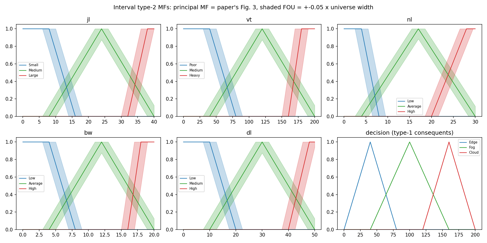
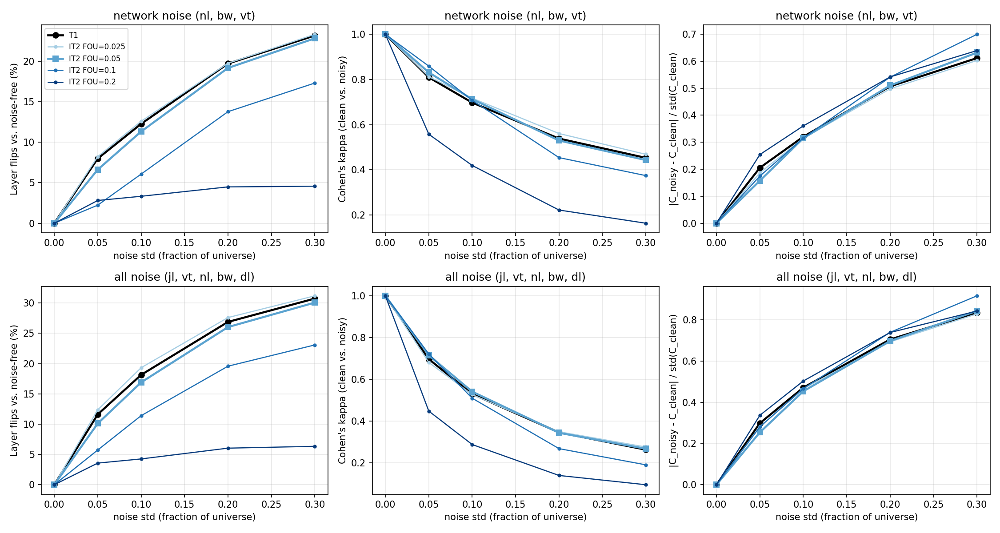
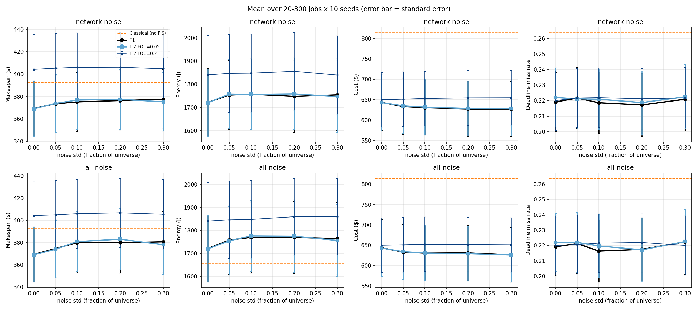

# 5. Gün — 11 Kasım 2026 (Çarşamba): Interval Type-2 FIS, Gürültü Deneyleri ve Kod İncelemesi

**Checkpoint:** CP4–CP5 — Özgün katkı
**Önerilen commitler (henüz atılmadı):** `Add interval type-2 FIS with Karnik-Mendel type reduction`, `Add IT2 offloading policy and input noise model`, `Add robustness experiments`, `Document paper deviations found in code review`

---

## Bugün ne yaptık? (özet)
1. Makalenin Type-1 FIS'ini **Interval Type-2 (IT2)** hale getiren bir çıkarım motoru yazdık: belirsizlik ayak izi (FOU), Karnik-Mendel tip indirgeme, durulaştırma.
2. Aynı simülatörde çalışan bir **IT2 offloading politikası** ekledik. Politika Type-1 politikanın alt sınıfı, yalnızca FIS değişiyor.
3. FIS girdilerine **ölçüm gürültüsü** ekleyip Type-1 ile IT2'yi karşılaştırdık: karar kararlılığı ve QoS metrikleri, 10 seed, eşli istatistik.
4. 2.–5. günlerin tüm kodunu **makaleye uygunluk ve performans** açısından inceledik.

> **En önemli sonuç (savunmada bunu anlat):** IT2 küçük gürültüde katman kararlarının değişmesini **anlamlı ama küçük** ölçüde azaltıyor (%8.0 → %6.6, p = 0.002) ve QoS metriklerini **hiç bozmuyor**. Büyük gürültüde fark kayboluyor. FOU'yu büyütmek kararları "kararlı" gösteriyor ama bu sahte bir kararlılık: sistem her şeye "Fog" demeye başlıyor. Bunu Cohen κ ile ölçerek gösterdik.

---

## 1. Neden Type-2? (motivasyon)
Makale bulanık mantığı "belirsiz ve hızla değişen koşullar" gerekçesiyle seçiyor. Ama Type-1 MF'te bir ölçümün üyelik derecesi **tek bir sayı**: 7.9 ms gecikme "Low" kümesine tam olarak 0.03 dereceyle ait. Ölçümün kendisi gürültülü ise bu kesinlik yanıltıcı.

Interval Type-2 kümede üyelik derecesi bir **aralık**: [alt MF, üst MF]. İkisinin arasındaki bant **FOU** (footprint of uncertainty, belirsizlik ayak izi). Literatürde IT2'nin gürültülü girdilerde daha pürüzsüz bir kontrol yüzeyi verdiği biliniyor. Biz bunu offloading probleminde test ettik.

## 2. IT2 üyelik fonksiyonları — `src/fuzzy/it2.py`
FOU'yu **tek parametreyle** ve **makalenin Şekil 3'üne sadık kalarak** kurduk:
- Ana (principal) MF = makalenin Type-1 MF'i.
- Okunan değer x, gerçek değerden en fazla ±δ sapmış olabilir. δ = `fou` × evren genişliği.
- **Üst MF:** `UMF(x) = max μ(z)`, z ∈ [x−δ, x+δ]. MF yatayda δ kadar genişler.
- **Alt MF:** `LMF(x) = min μ(z)`, aynı pencerede. MF δ kadar daralır.
- Pencere evrenle kırpılır. Böylece omuzlar evren sınırında 1 kalır (çekirdek pencereden genişse).
- Üçgen ve yamuk tek tepeli olduğu için max ve min **kapalı formda** hesaplanıyor (pencerenin iki ucuna bakmak yeterli). Testte kaba kuvvet pencere taramasıyla karşılaştırdık.
- `fou = 0` → alt MF = üst MF = makalenin MF'i.



**Çıktı kümeleri** Type-1 bırakıldı (`output_fou = 0`, parametreyle açılabiliyor). Sebep: crisp çıktının anlamı ve makalenin 60 / 140 eşikleri değişmesin.

## 3. IT2 çıkarım adımları
| Adım | Type-1 (makale) | IT2 (bizim) |
|---|---|---|
| Bulanıklaştırma | μ(x) | [LMF(x), UMF(x)] |
| Kural gücü (AND) | min | Ateşleme aralığı [min alt, min üst] |
| Çıkarım / birleştirme | min / max | Aynısı, alt ve üst sınır için ayrı ayrı → IT2 çıktı kümesi |
| Tip indirgeme | — | **Karnik-Mendel (KM)** ağırlık merkezi → [y_l, y_r] |
| Durulaştırma | COG | (y_l + y_r) / 2 |
| Eşikler | <60 Edge, 60–140 Fog, >140 Cloud | Aynısı |

- **Kod tekrarı yok:** 243 kural Type-1 motorundan derlenmiş haliyle alınıyor. Type-1 motorundaki ateşleme kodunu üç küçük metoda ayırdık (`membership_table`, `fire`, `term_strength`). IT2 bunları bir kez alt, bir kez üst dereceler için çağırıyor.
- **KM algoritması:** Ağırlık merkezi aralığının sol ucu için anahtarlama noktasının solundaki noktalar üst, sağındakiler alt ağırlıkla alınır. Sağ uç için tersi yapılır. Anahtarlama noktası değişmeyene kadar tekrarlanır. Doğrulama için tüm anahtarlama noktalarını kümülatif toplamla deneyen kesin bir yöntem de yazdık (`type_reduction="exhaustive"`). İkisi 1e-9 içinde aynı.
- **Aynı integral:** KM'de Type-1 COG ile aynı yamuk kuralı ağırlıklarını kullandık. Bu yüzden `fou = 0` iken IT2, Type-1 çıktısını **birebir** veriyor (200 rastgele girdide fark < 1e-9). Bu, IT2'nin makalenin sisteminin doğru bir genellemesi olduğunun kanıtı.

Örnek (demo komutu):
```
python -m src.fuzzy.paper_fis --jl 10 --vt 50 --nl 25 --bw 3 --dl 8 --fou 0.05
...
Defuzzified (centroid) = 40.00  ->  offload to Edge
Interval type-2 (FOU 0.05): type-reduced set [38.60, 46.03] (Karnik-Mendel)  ->  42.32  ->  offload to Edge
```
Type-1 tek bir sayı veriyor. IT2 ise bir **aralık** veriyor: kararın belirsizliğinin bir ölçüsü.

## 4. IT2 politikası ve gürültü modeli — `src/policies/fuzzy_policy.py`
- `IT2OffloadingPolicy(FuzzyOffloadingPolicy)`: yalnızca `make_fis()` metodunu değiştiriyor. QoS seçimi, gözlem eşlemesi, QoS kayması, eşikler ve deadline kontrolü **aynen** devralınıyor. Yani iki politika arasındaki her fark FIS'ten geliyor.
- `InputNoise(level, variables, seed)`: gözlenen FIS girdilerine Gauss gürültüsü ekliyor. Standart sapma = `level` × evren genişliği. Sonuç evrene kırpılıyor.
  - Gürültü yalnızca **(seed, görev no)** ile belirleniyor. Aynı görev her politikada aynı hatayı görüyor (ortak rastgele sayılar → eşli karşılaştırma).
  - Beş değişken her zaman aynı çekilişleri kullanıyor. "network" senaryosundaki `nl` hatası "all" senaryosundakiyle aynı.
- **Karar kararlılığını nasıl ölçtük:** Gürültü açıkken politika her kararda temiz girdiyle de FIS'i çalıştırıp kaydediyor. "Flip" = gürültülü katman kararı ≠ temiz katman kararı, **aynı simülatör durumunda**. Böylece iki ayrı simülasyonun birbirinden uzaklaşması karşılaştırmayı bozmuyor. Karar, deadline kontrolünden **önceki** FIS katmanı.
- Gürültü yalnızca FIS girdilerinde. Deadline kontrolünün EFT tahminleri gürültüsüz (bilinçli seçim, aşağıda sınırlamalarda).

## 5. Deney düzeni — `experiments/proposed/robustness_it2.py`
| Öğe | Değer |
|---|---|
| Senaryolar | `network`: nl, bw, vt (ağdan / VM'den ölçülen büyüklükler). `all`: beş girdinin hepsi |
| Gürültü seviyeleri | 0, 0.05, 0.1, 0.2, 0.3 (evren genişliğinin oranı olarak standart sapma) |
| Politikalar | Type-1 (makale), IT2 FOU = 0.025 / **0.05** / 0.1 / 0.2 |
| Ortam | Dengeli QoS tercihi (A5), MONTAGE 20 / 60 / 100 / 200 / 300 iş, test seed'leri 100–109 → her hücrede 50 eşli koşu |
| İstatistik | Eşli t-testi + Wilcoxon işaretli sıra testi (fark, aynı iş akışı ve aynı gürültü üzerinde) |
| Süre | ~2 dakika, 2 500 simülasyon |

**Ana FOU nasıl seçildi:** Ayar seed'lerinde (0–2, 60/100/200 iş) yaptığımız ön taramada FOU = 0.1 ve 0.2 gürültüsüz makespan'ı %5–7 kötüleştirdi. Gürültüsüz makespan / enerji / maliyeti Type-1'e ~%1 yakın tutan **en büyük FOU 0.05** idi. Bunu test seed'lerini koşmadan önce sabitledik. 4. gündeki ölçek sabitlerinde olduğu gibi, sonuçlara bakarak ayar yapmamak için.

**Cohen κ neden gerekli:** Ön taramada FOU = 0.2'nin kararların %98'ini Fog'a topladığını gördük. Her şeye "Fog" diyen bir sistem hiç flip yapmaz ama hiçbir şey de söylemez. κ, iki etiketleme arasındaki uyumu **şansa göre düzeltiyor**: 1 = aynı, 0 = şans düzeyi.

## 6. Sonuçlar
### 6.1 Karar kararlılığı — IT2 (FOU 0.05) ile Type-1, 50 eşli koşu
| Gürültü | `network` flip T1 → IT2 | κ T1 → IT2 | Wilcoxon p | `all` flip T1 → IT2 | κ T1 → IT2 | Wilcoxon p |
|---|---|---|---|---|---|---|
| 0.05 | %8.0 → **%6.6** | 0.81 → 0.83 | **0.002** | %11.6 → **%10.1** | 0.70 → 0.72 | **0.014** |
| 0.10 | %12.3 → %11.3 | 0.70 → 0.71 | 0.13 | %18.1 → %16.9 | 0.53 → 0.54 | 0.44 |
| 0.20 | %19.7 → %19.2 | 0.54 → 0.53 | 0.47 | %26.9 → %26.0 | 0.35 → 0.34 | 0.43 |
| 0.30 | %23.2 → %22.8 | 0.45 → 0.44 | 0.50 | %30.7 → %30.1 | 0.26 → 0.27 | 0.95 |



- **Küçük gürültüde** IT2, gürültünün yol açtığı flip'lerin **%13–18'ini** ortadan kaldırıyor. İstatistiksel olarak anlamlı ve κ da hafif artıyor (gerçek kararlılık, Fog'a yığılma değil).
- **Büyük gürültüde** fark anlamlı değil. ±%5'lik bir FOU, ±%10–30'luk hatayı emecek genişlikte değil. Beklenen bir sonuç: FOU, beklenen gürültüyle orantılı seçilmeli.
- `all` senaryosu daha zor: `jl` ve `dl` gürültüsü kararları `network` gürültüsünden daha çok değiştiriyor, çünkü 4. günde gördüğümüz gibi FIS kararlarını ağırlıklı olarak `jl`, `vt` ve `dl` yönlendiriyor.

### 6.2 FOU genişliğinin bedeli (gürültüsüz)
| FIS | Makespan (s) | Enerji (J) | Maliyet ($) | Deadline kaçırma | FIS'in Edge / Cloud payı | Karar başına süre (µs) |
|---|---|---|---|---|---|---|
| Type-1 (makale) | 369.4 | 1721 | 643.5 | %21.9 | %19 / %5.3 | 47 |
| IT2 FOU 0.025 | 366.7 | 1714 | 639.3 | %22.4 | %19 / %6.7 | 109 |
| **IT2 FOU 0.05** | **369.0** | **1720** | **643.0** | %22.2 | %19 / %5.5 | 116 |
| IT2 FOU 0.1 | 398.4 (+%7.9) | 1833 | 629.5 | %22.1 | %16 / %1.4 | 136 |
| IT2 FOU 0.2 | 404.3 (+%9.4) | 1841 | 649.8 | %22.0 | %4 / %0 | 259 |

(20–300 iş × 10 seed ortalaması; Şekil 4'teki 7 iş sayısından farklı bir küme olduğu için mutlak değerler `fig4_summary.csv` ile birebir aynı değil.)

- FOU 0.05 ile Type-1 arasındaki makespan / enerji / maliyet farkı **anlamsız** (p > 0.16). Tek anlamlı fark deadline kaçırmada **+0.28 yüzde puan** (p = 0.006). Çok küçük ama raporda dürüstçe söylenecek.
- **FOU büyüdükçe karar "ortaya" çöküyor:** KM tip indirgeme, belirsizlik arttıkça çıktı aralığını genişletir ve orta noktası evrenin ortasına (Fog = 100) kayar. FOU 0.2'de FIS hiç Cloud demiyor, Edge'i %4'e düşürüyor. Flip oranı %3–6'ya iniyor ama κ 0.1–0.5'e düşüyor. **Bu kararlılık değil, kararsızlık.** Makespan %9 kötüleşiyor.
- **Hesaplama maliyeti:** IT2 karar başına ~2.5 kat yavaş (47 → 116 µs; ölçüm makineye göre ±%10 oynuyor). Yine de 300 işlik bir iş akışı için toplam ~35 ms. Makalenin "düşük karmaşıklık" iddiasını bozmuyor.

### 6.3 Sistem düzeyinde dayanıklılık


Şaşırtıcı ama önemli bir bulgu: **Type-1 politikası da gürültüye karşı sistem düzeyinde dayanıklı.** Beş girdinin hepsine 0.3 gürültü eklendiğinde kararların %31'i değişiyor, ama makespan yalnızca %3 artıyor (369 → 381 s). Maliyet hatta düşüyor (643 → 626 $). Sebep: Alg. 5'teki **deadline kontrolü** ("dl not met") ve **MIN-MIN**, yanlış FIS katmanlarının çoğunu düzeltiyor. Bu yüzden T1 ile IT2'nin uçtan uca metrikleri hiçbir gürültü seviyesinde anlamlı biçimde ayrışmıyor (makespan ve maliyet farkı < %1). Enerjinin seed'den seed'e std'si büyük olduğu için tek tük p < 0.05 değerleri çoklu test etkisiyle yorumlanmalı.

## 7. Kod incelemesi (2.–5. günler)
Makale metnini (PDF) yeniden okuyarak kodla satır satır karşılaştırdık.

**Makaleyle uyumlu olduğu doğrulananlar:**
- Şekil 3 MF'leri, evrenler, çıktı [0, 200] ve eşikler (<60 Edge, 60–140 Fog, >140 Cloud; 60 ve 140 Fog'a dahil — makale "between 60 and 140" diyor).
- Mamdani: AND = min, çıkarım = min, birleştirme = max (MAM), COG (Denk. 21). scikit-fuzzy çapraz testi geçiyor.
- Tablo 2'deki 16 kural birebir (R1–R16 sırasıyla).
- Tablo 3: MIPS, UpBw, DownBw, çalışma / boşta güç, görev ve iletişim fiyatları birebir.
- Makespan = CT_last − ST_first (Denk. 12). Enerji boşta gücü içeriyor (makale: "load energy and idle energy").
- Makalenin üç örnek kuralı (R1–R3) üretilen 243 kuralla tutarlı.

**Makalenin sustuğu / çeliştiği ve kodda açık belgelenmemiş olan yerler — belgelendi (sayısal sonucu değiştirmeyen düzeltmeler):**
| Konu | Makale | Bizim seçim | Nerede belgelendi |
|---|---|---|---|
| Deadline | "15 unit deadline", birimsiz, tek değer | Görev başına slack, [0, 50] | `montage.py` |
| Düğüm hızı | Bölüm 2.1: 1200–1600 MIPS rastgele. Tablo 3: sabit | Tablo 3 | `nodes.py` |
| Cloud "Rate/MIPS = 0.001" | Birimi ve kullanımı yok | Kullanılmadı | `nodes.py` |
| Maliyet | Denk. 6 / 15: zaman × C_i × CCT | Görev fiyatı / s + iletişim fiyatı / MB | `nodes.py` |
| Offloading koşulu (Denk. 16–18) | Offloading ile yerel çalıştırma karşılaştırılır | Yalnızca deadline kısmı; Tablo 3'te IoT cihaz parametresi yok | `fuzzy_policy.py` |
| Alg. 5'teki λ1–λ3 eşikleri | Sayısal değer yok | 60 / 140 eşikleri; F1/F2/F3 dalları aynı 5 girdili FIS'i kullanıyor | `qos_selector.py` |
| Tablo 2 küme gösterimi L = (0, 0.5] | Biçim yok | Aralıklar destek (kapanış) olarak okundu: L(0) = 1, L(0.5) = 0 | `qos_selector.py` |

Bu maddeler `docs/makale_analizi.md` dosyasına da eklendi.

**Performans incelemesi:**
- 300 işlik bir simülasyon 38 ms, FIS kurulumu 0.9 ms. Profil çıkardık: zamanın çoğu FIS çıkarımında (karar başına bir kez, kaçınılmaz). MIN-MIN'in O(n²) turu algoritmanın kendisi, gereksiz iş değil. Sıcak döngüde tekrarlanan FIS kurulumu yok (politika başına bir kez).
- Gürültü yalnızca açıkken ve kayıt açıkken ek bir FIS değerlendirmesi yapılıyor (temiz karar için). Şekil 4 gibi gürültüsüz deneyler bu kodu hiç çalıştırmıyor.

**Type-1 yeniden üretimi bozulmadı:** Şekil 4, Tablo 4 ve baseline'ı yeniden ürettik. CSV'ler ve PNG'ler `git diff`'e göre **byte düzeyinde aynı**. Şekil 4: makespan **+%4.03**, enerji **−%4.18**, maliyet **+%21.94** (dünküyle aynı). Ayrıca `IT2OffloadingPolicy(fou=0)` ile Type-1 politikasının aynı atamaları ürettiği test ediliyor.

**İncelemede bulunan hatalar:**
- Bugünkü deney betiğinde bir **grafik hatası**: "all" senaryosunun gürültüsüz satırları tablonun sonuna eklendiği için çizgiler zikzak yapıyordu. Sıralamayı düzelttik (sayılar değişmedi).
- Kendi testimizde bir **beklenti hatası**: `Large = trap(32,38,40,40)` için FOU 0.1 (δ = 4) çekirdekten (2 birim) geniş olduğu için evren sınırında alt MF 1 değil 4/6. Kod doğruydu, test düzeltildi ve bu durum ayrıca test edildi.
- 2.–4. günlerin kodunda sonuçları değiştiren bir hata bulmadık.

## 8. Testler — 31 yeni test (`tests/test_it2.py`)
- Alt MF ≤ Type-1 MF ≤ üst MF; kapalı form sınırlar kaba kuvvet pencere taramasıyla aynı.
- `fou = 0` → alt = üst = Type-1 derecesi; IT2 FIS çıktısı = Type-1 çıktısı (200 rastgele girdi, 1e-9).
- KM = kesin anahtarlama noktası taraması (30 rastgele küme).
- Gömülü her Type-1 kümenin ağırlık merkezi [y_l, y_r] içinde (tip indirgemenin tanımı).
- Simetrik FOU → simetrik aralık; FOU büyüdükçe aralık genişliyor; ateşleme aralığı Type-1 ateşlemesini içeriyor.
- Belirgin senaryolarda (Edge / Fog / Cloud) IT2 aynı kararı veriyor.
- `IT2OffloadingPolicy(fou=0)` = Type-1 politikası (aynı atamalar).
- Gürültü: tekrarlanabilir, evrene kırpılıyor, yalnızca seçilen değişkenlere uygulanıyor, değişken kümesinden bağımsız çekiliyor; gürültü 0 sonucu değiştirmiyor; temiz karar aynı durumda kaydediliyor.

Toplam test sayısı: 71 + 31 = **102**.

## Savunmada sorulursa
- **"Neden Interval Type-2, neden General Type-2 değil?"** — IT2'de ikincil üyelik düz (hep 1). Tip indirgeme KM ile kesin ve hızlı. General Type-2 çok daha pahalı ve ikincil MF için makalede de bizde de veri yok. IT2 literatürdeki standart ilk adım.
- **"FOU'yu nasıl seçtiniz?"** — FOU, "okunan değer gerçek değerden en fazla ±δ sapabilir" demek. Tek parametre. Değerini test seed'lerine bakmadan ayar seed'lerinde, gürültüsüz performansı bozmayan en büyük değer olarak seçtik (0.05). Diğer değerleri de duyarlılık analizi olarak raporladık.
- **"Büyük FOU daha az flip yapıyor, neden onu seçmediniz?"** — Çünkü kararların neredeyse hepsi Fog'a gidiyor. κ ile gösterdik: flip az ama uyum şans düzeyine yakın. Üstelik makespan %9 kötü. Az flip ≠ iyi karar.
- **"IT2 neden büyük gürültüde yardım etmiyor?"** — FOU ±%5, gürültü ±%20–30. Belirsizlik modeli gerçek belirsizlikten çok darsa onu temsil edemez. Doğru tasarım, FOU'yu beklenen ölçüm hatasına göre ayarlamak. Ama geniş FOU bu sistemde kararı ortaya çökertiyor. Bu bir ödünleşim.
- **"Type-1 zaten dayanıklıysa IT2'ye ne gerek var?"** — Sistem düzeyindeki dayanıklılık FIS'ten değil, deadline kontrolünden geliyor. FIS kararının kendisi gürültüde %30'a varan oranda değişiyor. Deadline kontrolü olmayan bir ortamda (ör. makalenin saf algoritmaları ya da daha sıkı kaynaklar) bu flip'ler doğrudan QoS'e yansır. Bunu 6. gün ablation'ında `verify_deadline=False` ile ölçebiliriz.
- **"KM'nin yakınsadığını nereden biliyorsunuz?"** — KM sonlu adımda yakınsar (anahtarlama noktası monoton ilerler). Ayrıca tüm anahtarlama noktalarını deneyen kesin bir yöntemle karşılaştırıp testte doğruladık.

## Canlı demo komutları
```bash
python -m src.fuzzy.paper_fis --jl 10 --vt 50 --nl 25 --bw 3 --dl 8 --fou 0.05   # tek karar: T1 ve IT2 aralığı
python -m experiments.proposed.robustness_it2                                     # gürültü deneyi, ~2 dk
python -m pytest tests/test_it2.py -v
```

## Dürüst sınırlamalar
1. **Etki küçük:** IT2'nin anlamlı faydası yalnızca küçük gürültüde ve flip oranında. QoS metriklerinde anlamlı bir iyileşme yok.
2. **Gürültü modeli basit:** Bağımsız Gauss, kararlar arası korelasyon yok. Gerçek ağ ölçümlerinde gürültü zamansal olarak ilişkili ve çoğu zaman yanlı (bias).
3. **Deadline kontrolü gürültüsüz:** EFT tahminleri simülatörün gerçek değerlerini kullanıyor. Gerçekte bunlar da tahmin. Bu, sistem düzeyindeki dayanıklılığı olduğundan iyimser gösterebilir.
4. **FOU tasarımı tek bir aile:** "Belirsiz konum" tipi FOU. Belirsiz genişlik, belirsiz yükseklik gibi alternatifler denenmedi. Çıktı FOU'su varsayılan olarak kapalı.
5. **Tek iş akışı tipi** (MONTAGE) ve dengeli QoS tercihi. Saf algoritmalar (A2–A4) FIS kullanmadığı için gürültüden etkilenmiyor.
6. Kararlılık **deadline kontrolünden önceki** FIS katmanında ölçüldü. Son katmandaki değişim daha az olabilir.

## Yarın (6. gün)
Ablation: Mamdani vs Sugeno, durulaştırma yöntemleri (centroid / bisector / MOM), deadline kontrolü açık / kapalı (`verify_deadline=False`), boşta güç muhasebesi (`idle="all"`). Tablolar ve grafikler, literatür taraması.
