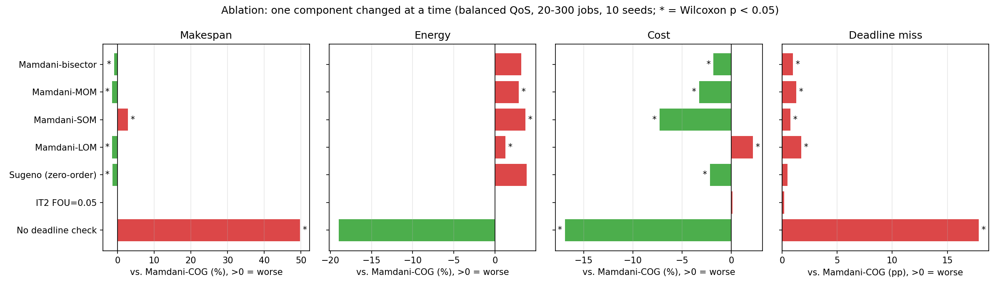
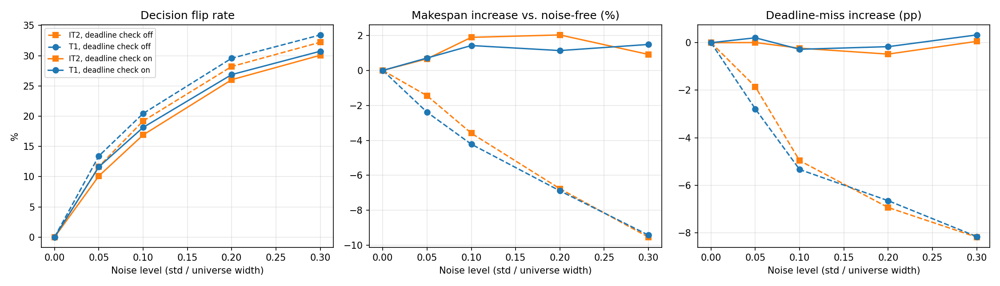

# 6. Gün — 14 Kasım 2026 (Cumartesi): Ablation, Sugeno, Literatür

**Checkpoint:** CP5 — Deneysel sonuçlar
**Önerilen commitler (henüz atılmadı):** `Add zero-order Sugeno FIS`, `Add ablation study`, `Add literature references and update README`

> Not: Plana göre bu gün 12 Kasım'daydı. 12–13 Kasım'da çalışılmadığı için 6., 7. ve 8. günler 14 Kasım'da birlikte yapıldı.

---

## Bugün ne yaptık? (özet)
1. Makalenin Mamdani sistemine karşılık **sıfırıncı dereceden Sugeno (TSK)** çıkarım motorunu yazdık.
2. Bir **ablation çalışması** yaptık: önerilen yöntemin bileşenlerini **tek tek** değiştirip etkisini ölçtük (çıkarım türü, durulaştırma yöntemi, deadline kontrolü, enerji muhasebesi).
3. 5. günde açık kalan soruyu test ettik: deadline kontrolü kapalıyken gürültü QoS'i bozuyor mu?
4. Kaynakçayı tamamladık (bulanık mantık teorisi, ilgili çalışmalar, istatistik).
5. Kod incelemesi: 5. gün belgesinde fazla güçlü bir istatistik ifadesi bulduk ve düzelttik.

> **En önemli sonuç (savunmada bunu anlat):** Önerilen yöntemin başarısını taşıyan bileşen **bulanık sistemin kendisi değil, Alg. 5'teki deadline kontrolü** ("dl not met"). Kontrol kapatılınca FIS işlerin %71'ini Fog'a, yalnızca %3'ünü Cloud'a gönderiyor; makespan %50 kötüleşiyor ve yöntem klasik baseline'dan %43 **daha kötü** hale geliyor. Durulaştırma yöntemi ya da Mamdani/Sugeno seçimi ise sonuçları yalnızca %1–3 oynatıyor ve hiçbiri centroid'e her metrikte üstün değil.

---

## 1. Sugeno çıkarımı — `src/fuzzy/sugeno.py`
**Mamdani ile farkı:** Mamdani'de kuralın sonucu bir bulanık küme (Edge üçgeni). Çıkarım bu kümeyi kırpar, kümeler birleştirilir ve alanın ağırlık merkezi alınır. **Sıfırıncı dereceden Sugeno**'da kuralın sonucu **sabit bir sayı**. Çıktı, kural güçleriyle ağırlıklı ortalama:

  y = Σ wᵢ · zᵢ / Σ wᵢ

- **Sabitler:** Makalenin çıktı kümelerinin tepe noktaları: Edge = 40, Fog = 100, Cloud = 160. Tek bir kural tam güçle ateşlenirse iki sistem aynı sayıyı verir. Böylece 60 / 140 eşikleri anlamını koruyor.
- **Kod tekrarı yok:** Bulanıklaştırma ve 243 kuralın ateşlenmesi Mamdani motorundan alınıyor (IT2'deki gibi). Yalnızca son adım farklı.
- `SugenoOffloadingPolicy`: önerilen politikanın alt sınıfı, yalnızca FIS değişiyor.
- Demo: `python -m src.fuzzy.paper_fis --jl 10 --vt 50 --nl 25 --bw 3 --dl 8 --sugeno`

## 2. Ablation deneyi — `experiments/proposed/ablation.py`
Her varyantta **yalnızca bir bileşen** değişiyor. Dengeli QoS tercihi (A5), MONTAGE 20–300 iş (Şekil 4'ün iş sayıları), test seed'leri 100–109 → 70 eşli koşu. Karşılaştırma makalenin yapılandırmasına (Mamdani + centroid) göre, aynı iş akışı üzerinde, Wilcoxon testiyle. Süre ~1.5 dakika.

### 2.1 Sistem düzeyinde sonuçlar (pozitif = makalenin yapılandırmasından **kötü**)
| Varyant | Makespan | Enerji | Maliyet | Deadline kaçırma |
|---|---|---|---|---|
| Mamdani + bisector | **−%1.0** | +%3.2 | **−%1.8** | **+1.0 puan** |
| Mamdani + MOM | **−%1.5** | **+%2.9** | **−%3.3** | **+1.3 puan** |
| Mamdani + SOM | **+%2.8** | **+%3.7** | **−%7.3** | **+0.8 puan** |
| Mamdani + LOM | **−%1.5** | **+%1.3** | **+%2.2** | **+1.7 puan** |
| Sugeno (0. derece) | **−%1.4** | +%3.8 | **−%2.2** | +0.5 puan |
| IT2 (FOU 0.05) | %0.0 | %0.0 | +%0.1 | +0.2 puan |
| **Deadline kontrolü yok** | **+%49.8** | −%19.0 | **−%16.9** | **+17.9 puan** |

Kalın = Wilcoxon p < 0.05. Kaynak: `results/tables/ablation_summary.csv`, grafik `results/figures/ablation_variants.png`.



### 2.2 FIS düzeyinde (3000 rastgele girdi, simülatör yok) — `ablation_fis.csv`
| Sistem | Makaleyle aynı katman | Edge / Fog / Cloud | Çıktının std'si | Karar başına süre |
|---|---|---|---|---|
| Mamdani + centroid (makale) | %100 | %15 / %84 / %1 | 24.2 | 51 µs |
| Mamdani + bisector | %93 | %20 / %76 / %4 | 26.5 | 65 µs |
| Mamdani + MOM | %81 | %28 / %64 / %8 | 33.8 | 60 µs |
| Mamdani + SOM | %80 | %33 / %64 / %3 | 32.4 | 52 µs |
| Mamdani + LOM | %79 | %12 / %76 / %12 | 37.7 | 54 µs |
| **Sugeno** | %93 | %21 / %76 / %3 | 26.4 | **30 µs** |
| IT2 FOU 0.05 | %98 | %15 / %83 / %2 | 23.2 | 162 µs |

**Yorumlar:**
- **Centroid "ortaya çeker":** Geniş Fog üçgeninin alanı, birleştirilmiş kümenin ağırlık merkezini 100'e doğru çeker. Bu yüzden centroid Type-1 sistemler arasında en az dağılan, en çok Fog diyen yöntem. Maksimum tabanlı yöntemler (MOM / SOM / LOM) alanı yok sayar, yalnızca en güçlü kurala bakar. Kararları daha keskin ama sıçramalı (bir kural diğerini geçince çıktı aniden atlar).
- **SOM ve LOM simetrik değil:** SOM en küçük maksimumu aldığı için Edge'e, LOM en büyüğü aldığı için Cloud'a kayıyor. SOM'un makespan'ı bu yüzden kötü (yavaş Edge), maliyeti iyi (bedava Edge).
- **Hiçbir varyant centroid'e her metrikte üstün değil.** Hepsi %1–3'lük bir ödünleşim: makespan ya da maliyet kazanılırken enerji ve deadline kaçırma kötüleşiyor. Yani makalenin COG seçimi savunulabilir.
- **Sugeno, bisector ile neredeyse aynı kararları veriyor ama %40 daha hızlı** (integral yok, yalnızca ağırlıklı ortalama). Makale "düşük karmaşıklık" iddia ediyor. Sugeno bu iddiayı daha iyi karşılar.

### 2.3 Deadline kontrolü: yöntemin asıl taşıyıcısı
| | Edge / Fog / Cloud payı | Makespan (klasiğe göre) |
|---|---|---|
| Önerilen (kontrol açık) | %26 / %44 / %30 | **%4.0 daha iyi** |
| Önerilen (kontrol kapalı) | %26 / %71 / %3 | **%43 daha kötü** |

- FIS dengeli tercihte işlerin büyük kısmına "Fog" diyor (2. gündeki bulgu: sistem Fog'a eğilimli). Cloud payının neredeyse tamamı FIS'ten değil, **deadline kontrolünden** geliyor: "Fog bu işi zamanında bitiremez, Cloud bitirir → Cloud".
- Bu, makaleye yönelik önemli bir eleştirel bulgu: makale başarıyı bulanık sisteme atfediyor, ama yeniden üretimimizde iyi sonucun büyük kısmı basit, kesin (crisp) bir kontrolden geliyor.

### 2.4 Enerji muhasebesi — `ablation_idle.csv`
| Boşta güç kimin için sayılıyor | Klasik (J) | Önerilen (J) | Önerilenin kazancı |
|---|---|---|---|
| Yalnızca kullanılan düğümler (bizim varsayılan) | 1463 | 1523 | −%4.2 |
| Tüm düğümler | 1511 | 1553 | −%2.8 |

Muhasebe seçimi farkı küçültüyor ama işareti değiştirmiyor: önerilen yöntem enerjide iki muhasebede de kötü. Enerji kaybının nedeni 4. günde bulunmuştu: önerilen yöntem Cloud'a az iş gönderdiği halde Cloud düğümleri boşta 1300 mW harcıyor.

## 3. Gürültü + deadline kontrolü kapalı — `ablation_noise_nodeadline.csv`
5. günde şu hipotezi kurmuştuk: "Sistem düzeyindeki dayanıklılık deadline kontrolünden geliyor. Kontrol olmasa flip'ler QoS'e yansır ve IT2'nin faydası görünür."

Sonuç: **hipotez reddedildi.**

| Gürültü | Flip T1 / IT2 | Makespan değişimi T1 / IT2 (kontrol kapalı) | Makespan değişimi T1 / IT2 (kontrol açık) |
|---|---|---|---|
| 0.05 | %13.4 / %11.7 | −%2.4 / −%1.4 | +%0.7 / +%0.7 |
| 0.10 | %20.4 / %19.2 | −%4.2 / −%3.6 | +%1.4 / +%1.9 |
| 0.20 | %29.6 / %28.2 | −%6.9 / −%6.8 | +%1.1 / +%2.0 |
| 0.30 | %33.4 / %32.2 | −%9.4 / −%9.5 | +%1.5 / +%0.9 |



- Kontrol kapalıyken gürültü makespan'ı **iyileştiriyor** (%9'a kadar) ve deadline kaçırmayı azaltıyor. Sebep: kontrol kapalıyken gürültüsüz FIS işlerin %71'ini Fog'a yığıyor (200 işte %84). Gürültü kararların bir kısmını Edge'e ve Cloud'a dağıtıyor (200 işte Cloud payı %5 → %11). Kalabalık Fog'dan iş almak, gürültünün yanlış kararlarından daha çok fayda sağlıyor. Bedeli enerji: %20'ye varan artış (boşta Cloud gücü).
- IT2 burada da T1'den %1'den fazla ayrışmıyor.
- **Ders:** Flip sayısı "kötü karar" demek değil. Gürültüsüz kararın kendisi optimal değilse, ondan sapmak zarar vermeyebilir. Bu, 5. günün "IT2 flip'leri azaltıyor" bulgusunun pratik değerini sınırlıyor. Raporda dürüstçe yazılacak.

## 4. Literatür — `references/README.md`
Kaynakçaya eklenenler (IEEE formatında):
- **Bulanık mantık teorisi:** Zadeh 1965 (bulanık kümeler), Mamdani & Assilian 1975, Takagi & Sugeno 1985, Karnik & Mendel 2001 (tip-2 kümenin ağırlık merkezi), Liang & Mendel 2000 (IT2 FLS), Mendel & John 2002, Wu & Mendel 2009 (gelişmiş KM).
- **İlgili çalışmalar:** Bonomi vd. 2012 (fog computing), Mach & Becvar 2017 (MEC ve offloading taraması), Braun vd. 2001 (MIN-MIN), Deelman vd. 2005 ve Juve vd. 2013 (MONTAGE iş akışı).
- **İstatistik:** Wilcoxon 1945, Cohen 1960 (κ).
- Mevcut olanlar: Soni & Kumar 2024 (referans makale), Sonmez vd. 2019 (edge'de bulanık iş yükü düzenleme — makalenin en yakın öncülü), Khan vd. 2023 (baseline), Liu vd. 2019 (FogWorkflowSim), Kumari vd. 2022 (offloading taraması).

**Uyarı:** Künyeler bilgimden yazıldı, internetten tek tek doğrulanmadı. Teslimden önce Google Scholar'dan sayfa ve cilt numaralarına göz atmakta fayda var.

### Literatürdeki yerimiz (raporun Related Work bölümünün özeti)
| Çalışma | Yöntem | Bizim farkımız |
|---|---|---|
| Sonmez vd. 2019 | Type-1 Mamdani FIS, edge–cloud iş yükü düzenleme | Üç katman, IT2, gürültü analizi |
| Khan vd. 2023 | Kesin kurallı iki yönlü fog–cloud offloading | Aynı simülatörde yeniden koşuldu (adil karşılaştırma) |
| Soni & Kumar 2024 | Type-1 Mamdani, QoS seçici, FogWorkflowSim | Yeniden üretim + IT2 + Sugeno/durulaştırma ablation + istatistik |
| Liang & Mendel 2000, Mendel & John 2002 | IT2 FLS teorisi | Offloading problemine uygulandı, FOU tek parametreyle tanımlandı |

## 5. Kod incelemesi (makaleye uygunluk ve performans)
- **Sugeno makaleyle çelişmiyor:** Makalenin sistemi Mamdani. Sugeno yalnızca ablation olarak ekli, varsayılan davranış değişmedi.
- **Type-1 yeniden üretimi bozulmadı:** Şekil 4, Tablo 4, baseline ve gürültü deneyini yeniden koştuk. Takip edilen tüm sonuç dosyaları **byte düzeyinde aynı** (aşağıda test bölümü).
- **Bulunan hata (belgede):** 5. gün günlüğü ve README "T1 ile IT2'nin uçtan uca metrikleri hiçbir gürültü seviyesinde anlamlı ayrışmıyor" diyordu. `robustness_paired.csv`'de ise makespan'da p < 0.01 olan iki satır var (gürültü 0.2: IT2 %0.8 kötü; 0.3: IT2 %0.6 iyi). Farklar küçük ve işareti değişiyor, ama "anlamlı değil" ifadesi yanlıştı. İkisi de düzeltildi ("%1 içinde, tutarlı bir avantaj yok").
- **Performans:** Ablation 70 iş akışı × 11 simülasyon + gürültü deneyi ~1.5 dakikada bitiyor. Sugeno, Mamdani'den hızlı (çıktı evreni üzerinde integral yok).

## 6. Testler — 11 yeni test (`tests/test_sugeno.py`)
- Sabitler çıktı kümelerinin tepe noktaları (40 / 100 / 160).
- Çıktı = kural sabitlerinin ağırlıklı ortalaması (elle hesapla karşılaştırma).
- Çıktı her zaman [40, 160] içinde.
- Tek kural tam ateşlenince Sugeno = o kuralın sabiti, Mamdani ile aynı katman.
- Rastgele girdilerin %85'inden fazlasında Mamdani ile aynı katman.
- Ablation politikaları (Sugeno, bisector, MOM, deadline kontrolü kapalı) tüm görevleri zamanlıyor.

Toplam: 102 + 11 = **113 test**.

## Savunmada sorulursa
- **"Neden Sugeno'yu ana yöntem yapmadınız, daha hızlı?"** — Makale Mamdani kullanıyor. Yeniden üretimde makaleye sadık kaldık. Sugeno'yu ablation olarak ölçtük: %40 hızlı, sonuçlar %1–3 içinde ama hiçbir metrikte tutarlı biçimde daha iyi değil.
- **"Hangi durulaştırma en iyi?"** — Tek bir en iyi yok. Centroid en dengeli (en düşük deadline kaçırma ve enerji). MOM/LOM makespan'ı biraz iyileştiriyor, SOM maliyeti. Seçim kullanıcının önceliğine bağlı.
- **"O zaman bulanık mantığa ne gerek var, deadline kontrolü yetiyor mu?"** — Hayır. Baseline de bir deadline kontrolüne sahip ama Edge'i hiç kullanmıyor. Bulanık sistemin katkısı işlerin %26'sını bedava Edge'e göndermek. Maliyetteki %22'lik kazanç buradan geliyor. Ama Cloud kararlarının çoğu FIS'ten değil, kontrolden geliyor.
- **"Gürültü makespan'ı nasıl iyileştirebilir?"** — Gürültüsüz FIS optimal değil, işleri Fog'a yığıyor. Gürültü rastgele yük dağıtımı gibi davranıyor. Bu, FIS'in kural tabanının ya da QoS kaymasının iyileştirilebileceğini gösteriyor (gelecek çalışma: kural / MF optimizasyonu).

## Dürüst sınırlamalar
1. Ablation tek bir QoS tercihinde (dengeli) ve tek iş akışı tipinde yapıldı.
2. Sugeno sabitleri tepe noktalardan seçildi, optimize edilmedi. Birinci dereceden (doğrusal sonuçlu) Sugeno denenmedi.
3. Durulaştırma varyantları yalnızca Type-1'de. IT2'de KM dışındaki tip indirgeme yöntemleri (ör. Nie-Tan) denenmedi.
4. Literatür künyeleri internetten doğrulanmadı.

## Canlı demo komutları
```bash
python -m src.fuzzy.paper_fis --jl 10 --vt 50 --nl 25 --bw 3 --dl 8 --sugeno --defuzz mom
python -m experiments.proposed.ablation          # ~1.5 dk
python -m pytest tests/test_sugeno.py -v
```
